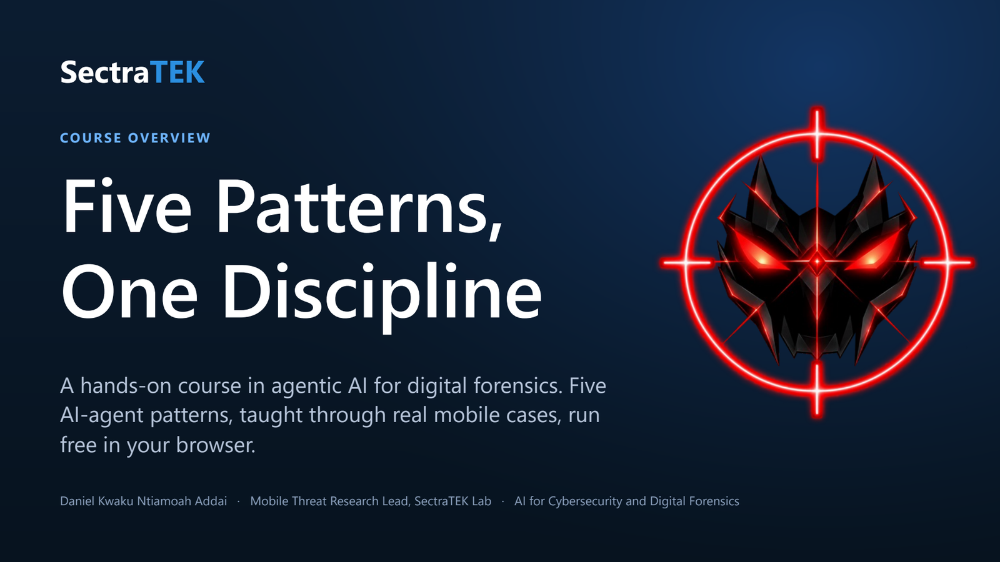
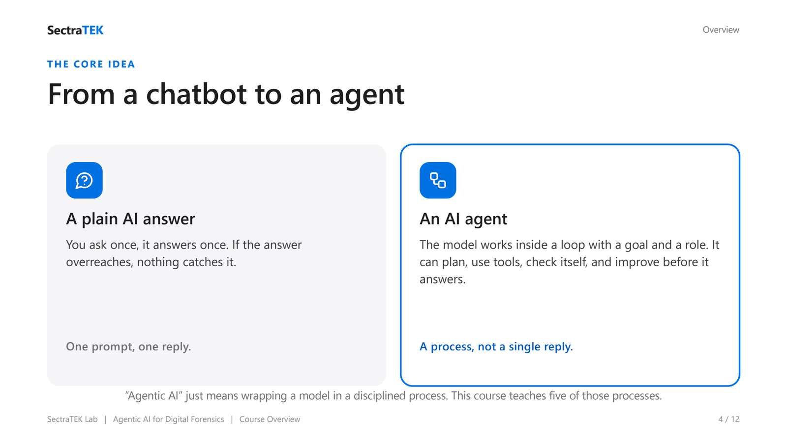
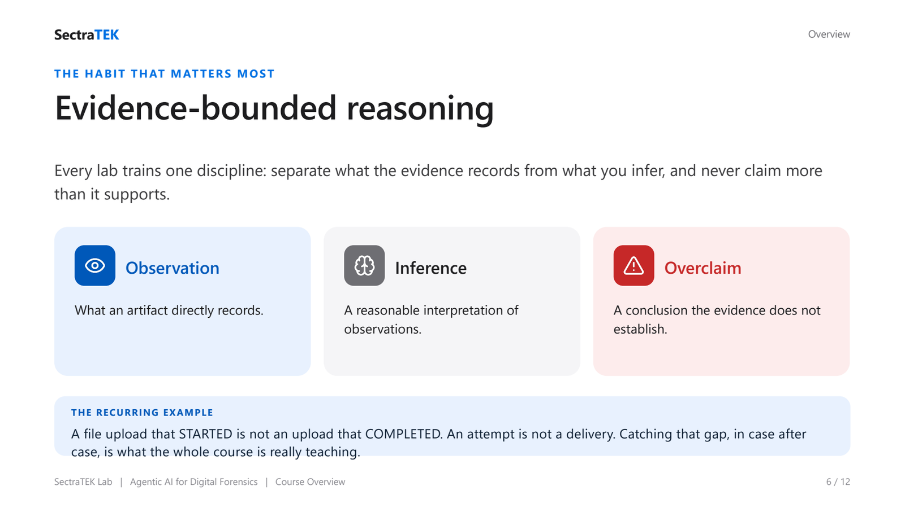
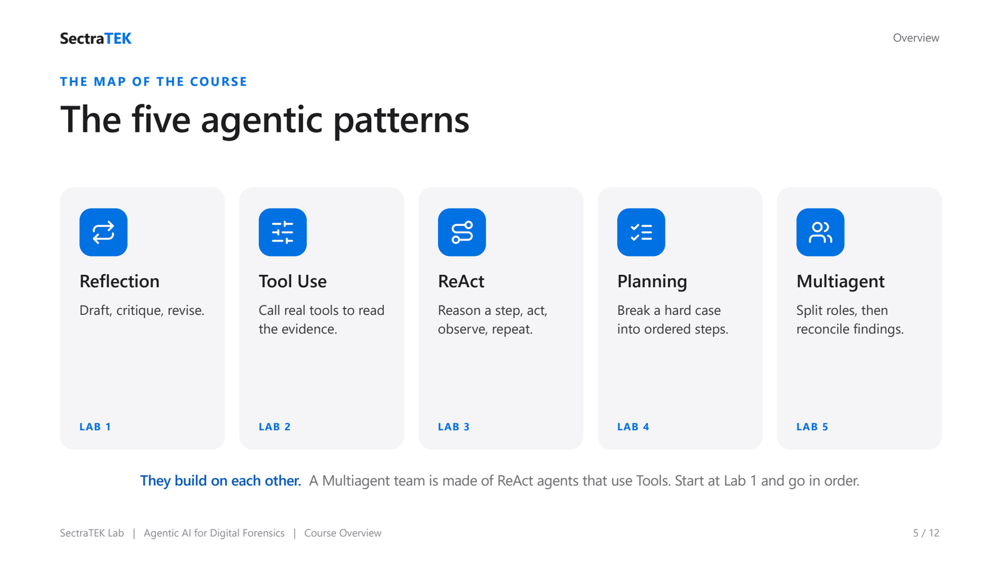
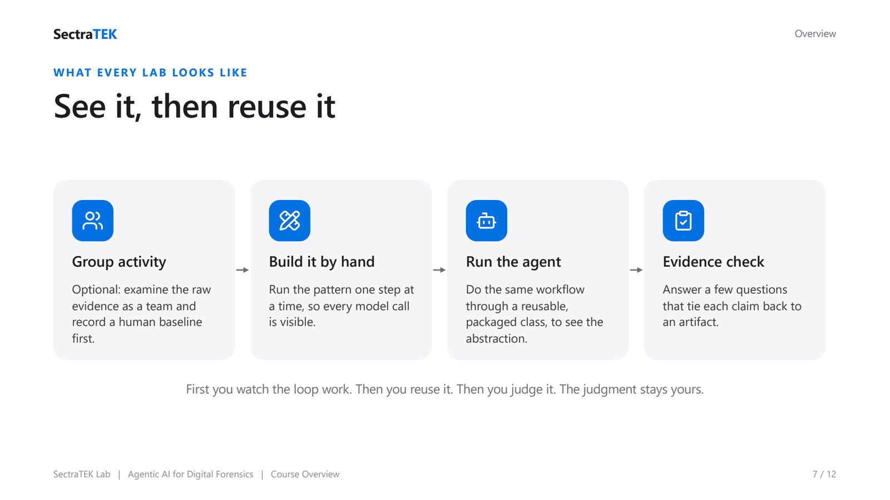

  

# SectraTEK AI Lab: Agentic AI for Digital Forensics

> A hands-on teaching lab that uses agentic AI design patterns to make digital-forensic
> reasoning more disciplined, more defensible, and easier to learn. Every lab runs in a
> hosted notebook (Google Colab) with a free model endpoint, so students install nothing on
> their own machines.

**Course:** AI for Cybersecurity and Digital Forensics
**Author and instructor:** Daniel Kwaku Ntiamoah Addai, Mobile Threat Research Lead, SectraTEK Lab ([lab.sectratek.com](https://lab.sectratek.com))
**Status:** All five labs available.

**New here?** Start with the [Course Overview deck](course_overview/) for a 12-slide tour of the five patterns and how the labs run.

---

## Abstract

Large language models can draft a forensic report in seconds, but a fast draft is not a
defensible one: models state inferences as facts, claim outcomes the evidence does not
establish, and hide uncertainty behind fluent prose. This repository teaches a set of
**agentic AI design patterns** that wrap a model in a disciplined process, so the model
checks its own work, calls real tools instead of guessing, plans before it answers, and
divides an investigation across cooperating roles. Each pattern is taught through one
synthetic mobile-forensics case. The labs are written for cybersecurity and digital-forensics
students who may be new to programming, and they run entirely in a hosted notebook with a free
model endpoint. The learning objective is not to automate the examiner, but to give the
examiner a faster, more honest assistant whose claims stay inside the evidence.

---

## Table of contents

1. [Background](#1-background)
2. [Problem statement](#2-problem-statement)
3. [Gaps in current practice](#3-gaps-in-current-practice)
4. [Our solution](#4-our-solution)
5. [Methods and approach](#5-methods-and-approach)
6. [Practical: how to run the labs](#6-practical-how-to-run-the-labs)
7. [Lab index](#7-lab-index)
8. [Discussion](#8-discussion)
9. [Limitations and ethics](#9-limitations-and-ethics)
10. [Credits and provenance](#10-credits-and-provenance)
11. [License](#11-license)

---

## 1. Background

Digital forensics is the practice of recovering, preserving, and interpreting data from
devices so that the result can withstand scrutiny, often in a legal setting. The discipline
rests on a few non-negotiable ideas: evidence integrity (the data is what it claims to be and
has not been altered), provenance (every finding traces back to a specific artifact), and
defensibility (a claim is only as strong as the evidence and the reasoning behind it).

Two forces now press on this discipline at once:

- **The volume problem.** A single modern phone can hold hundreds of thousands of artifacts.
  Examiners cannot read everything, so triage and summarization matter more each year.
- **The AI opportunity, and its risk.** Large language models (LLMs) can read, summarize, and
  draft at a scale no human can match. Used naively, they also produce confident, well-written
  conclusions that are not supported by the evidence. In forensics, a plausible-sounding but
  unsupported claim is worse than no claim at all.

**Agentic AI** is the bridge. Instead of asking a model for a single answer, an agent places
the model inside a structured loop with a goal and a role, so it can review, verify, plan, and
collaborate before it returns a result. The same design patterns that make general AI agents
more reliable turn out to map cleanly onto the habits of a careful investigator.

   
  <em>The core idea: a plain chatbot answers once and nothing catches an error; an agent puts the model in a loop with a goal and a role, so it reviews and verifies before it answers.</em>

---

## 2. Problem statement

> **How can we teach students to use LLMs in digital forensics without teaching them to trust
> an overconfident machine, and do it on hardware they already have?**

The problem has three parts:

1. **Rigor.** A forensic report must separate observation from inference, cite an artifact and
   a timestamp for every claim, and state what remains uncertain. A raw LLM does none of this
   by default.
2. **Pedagogy.** Students learning this for the first time need to *see* the reasoning process,
   not just a finished answer. They need a worked loop they can step through, then a reusable
   abstraction they can apply.
3. **Access.** Many students do not have a GPU, administrator rights on their laptops, or the
   patience to install a local model server. A lab that requires a local install excludes the
   very students it is meant to reach.

---

## 3. Gaps in current practice

| Gap | What goes wrong today | What a student needs instead |
|---|---|---|
| **Overclaiming** | LLM reports assert delivery, intent, or guilt that the artifacts never establish. | A process that forces each claim back to a named artifact and timestamp. |
| **Single-shot answers** | One prompt, one answer, no self-check. Errors ship unexamined. | A loop where the model critiques and revises before anyone reads the result. |
| **Local-install labs** | Existing agentic-AI labs assume a local model server (for example Ollama) and often a GPU. | A hosted notebook with a free endpoint, nothing installed locally. |
| **Opaque tooling** | "Magic" agent frameworks hide the loop, so students learn the library, not the idea. | A manual build of the loop first, then the packaged version. |
| **Missing forensic framing** | General agent tutorials use trivia tasks with no notion of evidence or defensibility. | Real, synthetic forensic cases with artifacts, chain of custody, and an evidence boundary. |

---

## 4. Our solution

**SectraTEK AI Lab** teaches five agentic AI design patterns, each through one synthetic
mobile-forensics case, with three design commitments:

1. **Evidence-bounded by construction.** Every lab is built around the discipline of separating
   observation, inference, and claim, and of citing an artifact for each statement. The AI is a
   critique and triage aid; the forensic judgment stays with a human.
2. **Hosted, zero-install.** Every notebook runs in Google Colab (or any hosted Jupyter) against
   a free, OpenAI-compatible model endpoint. Students open one notebook, paste one free key, and
   run. Nothing is installed on their own computer.
3. **See it, then reuse it.** Each lab first builds the pattern by hand, one cell at a time, so
   the student sees every model call. Then it runs the same workflow through a small reusable
   class, so the student learns the abstraction without the loop becoming magic.

   
  <em>The discipline every lab trains: separate what the artifacts record (observation) from a reasonable interpretation (inference), and never claim what the evidence does not establish (overclaim).</em>

### The five patterns

| Pattern | The investigator's habit it mirrors | Lab |
|---|---|---|
| **Reflection** | Draft, self-critique, revise. | [Lab 1](lab1_reflection_pattern/) |
| **Tool Use** | Inspect the artifact with a real tool instead of guessing. | [Lab 2](lab2_tool_use_pattern/) |
| **ReAct** | Reason one step, act, observe, repeat. | [Lab 3](lab3_react_pattern/) |
| **Planning** | Break a hard question into checkable steps. | [Lab 4](lab4_planning_pattern/) |
| **Multiagent** | Split roles, compare findings, reconcile. | [Lab 5](lab5_multiagent_pattern/) |

   
  <em>The five patterns build on each other: Reflection, Tool Use, ReAct, Planning, then Multiagent. Start at Lab 1 and go in order.</em>

---

## 5. Methods and approach

### 5.1 Model runtime

The labs use a hosted, OpenAI-compatible endpoint. The default is the **Groq free tier**
(`https://api.groq.com/openai/v1`), which serves open models at no cost and needs no credit
card. The API key is collected inside the notebook with a hidden prompt (`getpass`) and is never
written into the file. Because the client is OpenAI-compatible, an instructor can point any lab
at a different endpoint (a campus server, a different provider, or a local Ollama for offline
rooms) by changing two values. See [docs/GROQ_SETUP.md](docs/GROQ_SETUP.md).

### 5.2 Lab structure

Every lab follows the same four-stage pedagogy:

1. **Pre-lab evidence analysis (optional, un-graded).** Students examine the raw artifacts as a
   group, build a timeline, and record a human baseline before any model is involved.
2. **Build the loop by hand.** The notebook walks the pattern one model call at a time, with a
   short *Purpose / Input / Output* note on each step.
3. **Run the packaged agent.** The same workflow runs through a small reusable class that mirrors
   the `agentic_patterns` library, so the student sees the abstraction.
4. **Evidence check.** The student answers a short set of questions that force each claim back to
   an artifact and name what remains uncertain.

   
  <em>Every lab follows the same path: look at the raw evidence first, build the loop by hand so every model call is visible, run the same workflow through a small reusable class, then check each claim against an artifact.</em>

### 5.3 Synthetic data

Every case is **synthetic** and built for teaching. Each lab ships an artifact manifest, a chain
of custody log, and case-specific artifacts (file events, messages, network, location, and so
on). No real personal data is used anywhere in this repository.

---

## 6. Practical: how to run the labs

**Students (the fast path):**

1. New to the course? Skim the [Course Overview deck](course_overview/) first. Then open the lab you
   want (start with [Lab 1](lab1_reflection_pattern/)) and click the
   **Open in Colab** badge in its notebook.
2. Run the setup cells. When prompted, paste a free Groq API key
   (see [docs/GROQ_SETUP.md](docs/GROQ_SETUP.md)). The key is hidden and is not saved.
3. Work through Part A and Part B, then answer the evidence-check questions.
4. Save your notebook (`File -> Download -> Download .ipynb`, or save a copy to Drive) and submit
   as your instructor directs.

You do not need to install Python, clone this repository, or own a GPU. The notebook writes its
own data and defines everything it needs.

**Instructors:** see [docs/INSTRUCTOR_GUIDE.md](docs/INSTRUCTOR_GUIDE.md) for the teaching
sequence, the slide decks, assessment rubrics, and how to point the labs at a different model
endpoint.

---

## 7. Lab index

| # | Lab | Pattern | Case | Materials |
|---|---|---|---|---|
| 1 | [Reflection Pattern](lab1_reflection_pattern/) | Reflection | Suspected customer-data exfiltration (DF-2026-017) | Notebook, data, [slides](lab1_reflection_pattern/slides/) |
| 2 | [Tool Use Pattern](lab2_tool_use_pattern/) | Tool Use | Stolen-vehicle sale preparation (TU-2026-004) | Notebook, data, [slides](lab2_tool_use_pattern/slides/) |
| 3 | [ReAct Pattern](lab3_react_pattern/) | ReAct | Signal attempt during an unattended interval (RA-2026-009) | Notebook, data, [slides](lab3_react_pattern/slides/) |
| 4 | [Planning Pattern](lab4_planning_pattern/) | Planning | Missing-phone timeline reconstruction (PL-2026-011) | Notebook, data, [slides](lab4_planning_pattern/slides/) |
| 5 | [Multiagent Pattern](lab5_multiagent_pattern/) | Multiagent | Transmission and chain-of-custody review (MA-2026-022) | Notebook, data, [slides](lab5_multiagent_pattern/slides/) |

Each lab folder has its own `README.md` written in the same research-paper structure as this one.

### Further labs: LLMs for forensics

Beyond the five agentic-pattern labs, this repository also hosts standalone labs that apply language
models to forensic tasks:

| Lab | Pattern | What it teaches |
|---|---|---|
| [RAG over DF reports](df_llm_labs/lab3_rag/) | Retrieval-Augmented Generation | Build a RAG from scratch so a model answers questions about case reports, grounded in them and cited. |
| [Forensic agent over an Android image](df_llm_labs/lab4_qwen/) | Tool-using agent (ReAct) | Build an agent that lets a lightweight Qwen model walk a device image, answer a question, and cite the exact file it used. |

---

## 8. Discussion

**Why Reflection comes first.** Self-review is the smallest agentic loop and the habit every
later pattern depends on. A student who can make a model critique and revise its own forensic
claim is ready to understand tool use, planning, and multi-agent review.

**What students actually learn.** The technical skill is wiring an LLM into a loop. The deeper
skill, the one that transfers to real casework, is the discipline of evidence-bounded writing:
saying "the artifacts show" instead of "the suspect did," and naming the boundary of what the
evidence can support.

**The role of the human.** None of these patterns make the model the examiner. They make the
model a faster, more honest assistant that removes obvious overreach before a qualified human
reads the report and owns the final judgment.

---

## 9. Limitations and ethics

- **Synthetic cases only.** The data is designed to teach reasoning, not to mirror the full
  complexity of a real acquisition.
- **Models change.** Hosted model availability and behavior shift over time. The notebooks
  default to a current model and recover gracefully if a model name is retired.
- **Not legal advice.** These labs teach method, not courtroom procedure. Real investigations are
  governed by law, policy, and qualified human examiners.
- **Responsible use.** The exfiltration and surveillance scenarios are teaching devices. They are
  framed from the examiner's side and must not be used to build or conceal real misconduct.

---

## 10. Credits and provenance

This course is adapted from **frankwxu/agentic-AI4-forensics**
(https://github.com/frankwxu/agentic-AI4-forensics), which provides the original course concept,
the forensic case design, and the lab sequence. We gratefully acknowledge that work.

The agent workflow code is adapted from **The Neural Maze's agentic-patterns-course**
(https://github.com/neural-maze/agentic-patterns-course) and is reused under the MIT License. The
original copyright and permission notice are preserved in
[THIRD_PARTY_NOTICES.md](THIRD_PARTY_NOTICES.md).

The SectraTEK adaptation (hosted zero-install runtime, self-contained notebooks, the slide decks,
and this documentation) is by Daniel Kwaku Ntiamoah Addai, SectraTEK Lab.

---

## 11. License

The adapted course materials in this repository are provided for educational use. Third-party
code retains its original license as recorded in [THIRD_PARTY_NOTICES.md](THIRD_PARTY_NOTICES.md).
For any other use, contact SectraTEK Lab.
