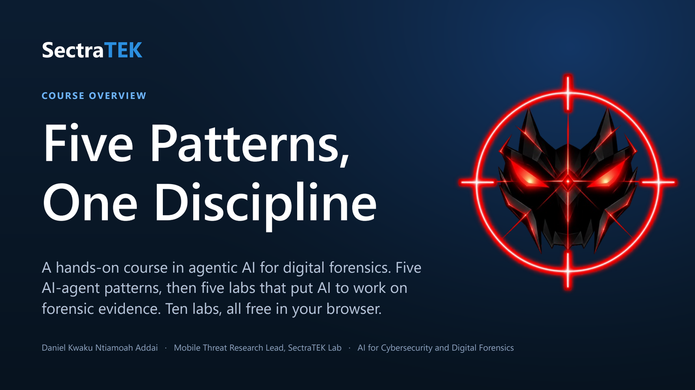
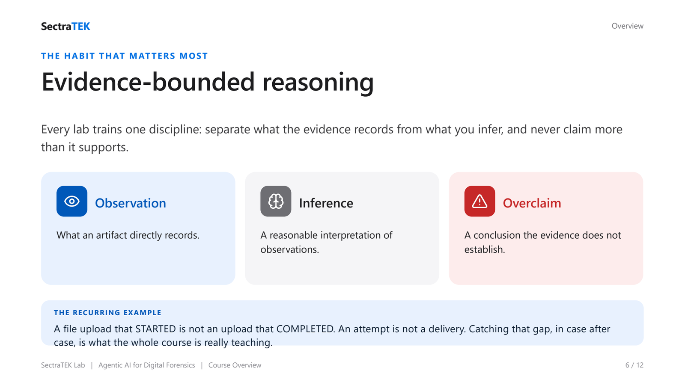

# Course Overview

Start here. This page introduces the whole course for students and instructors: what you will build,
what you need, and the order to work the labs in.

  

- **[SectraTEK_Course_Overview.pdf](SectraTEK_Course_Overview.pdf)** ([.pptx](SectraTEK_Course_Overview.pptx)) - a 12-slide deck
  that introduces agentic AI, the five agent patterns, the evidence-bounded habit that runs through every
  lab, how the labs run (free, in the browser), the syllabus for Labs 01-05, and how to begin.
  Labs 06-10 each have their own deck in their lab folder.

## What you need

- A web browser and a Google account (for Colab). No installs, no GPU, no cost.
- A free [Groq](https://console.groq.com/keys) API key. One key works for all ten labs; the notebook asks
  for it with a hidden prompt and never saves it. See [GROQ_SETUP.md](../docs/GROQ_SETUP.md), which also
  explains the free-tier limits and what to do when you hit one.

## What the course teaches

**Five patterns.** Each of the first five labs builds one agent pattern by hand, then runs the same
workflow through a small reusable class.

| Pattern | The investigator's habit it mirrors | Lab |
|---|---|---|
| **Reflection** | Draft, self-critique, revise. | [Lab 01](../lab01_reflection_pattern/) |
| **Tool Use** | Inspect the artifact with a real tool instead of guessing. | [Lab 02](../lab02_tool_use_pattern/) |
| **ReAct** | Reason one step, act, observe, repeat. | [Lab 03](../lab03_react_pattern/) |
| **Planning** | Break a hard question into checkable steps. | [Lab 04](../lab04_planning_pattern/) |
| **Multiagent** | Split roles, compare findings, reconcile. | [Lab 05](../lab05_multiagent_pattern/) |

**One discipline.** Separate what the artifacts record (observation) from a reasonable reading of it
(inference), and never claim what the evidence does not establish (overclaim).

  

**The code checks the AI, too.** Giving a model access to the evidence limits what it can look at, not
what it can say. In testing, a model asked about a memory image described a hidden process and a
malicious DLL that do not exist, without running a single tool. So the agent in Labs 07-10 checks
every answer before you see it:

1. **Did it look?** At least one tool must have run for the question.
2. **Is every specific real?** Every process ID, IP address, memory address, and file name in the
   answer must appear in something a tool actually returned.
3. **Is the citation honest?** The answer cannot cite a tool that never ran.

An answer that fails goes back to the model to confirm with a tool or drop the claim. If it still
cannot back it up, it arrives marked **UNVERIFIED**. You see every check in the reasoning trace. The
check catches invented details; it cannot catch a wrong reading of real evidence. That part stays your
job: **the AI assists, you decide.**

## The labs, in order

Work the agentic-pattern labs first, in order. Each is a synthetic forensic case.

1. [Lab 01: Reflection](../lab01_reflection_pattern/) - suspected customer-data exfiltration
2. [Lab 02: Tool Use](../lab02_tool_use_pattern/) - stolen-vehicle sale preparation
3. [Lab 03: ReAct](../lab03_react_pattern/) - a Signal attempt during an unattended interval
4. [Lab 04: Planning](../lab04_planning_pattern/) - missing-phone timeline reconstruction
5. [Lab 05: Multiagent](../lab05_multiagent_pattern/) - transmission and chain-of-custody review

Then the LLM-for-forensics labs, which apply those patterns to forensic evidence:

6. [Lab 06: RAG over case reports](../lab06_llm_rag_case_reports/) - answers grounded in, and cited from, case reports
7. [Lab 07: An agent over an Android image](../lab07_llm_android_image_agent/) - walks a device image and cites the exact file
8. [Lab 08: Bug-report chatbot](../lab08_llm_bug_report_chatbot/) - the same agent over an Android bug report, even one from your own phone
9. [Lab 09: Incident-response copilot](../lab09_llm_incident_response_copilot/) - works from an IR plan, playbooks, and an ISO 27001 ISMS; actions are approval-gated and simulated
10. [Lab 10: Memory forensics with Volatility 3](../lab10_llm_memory_forensics_volatility/) - a real public memory image with a ground-truth answer key

Every lab folder has its own README, slide deck, and an **Open in Colab** notebook. Labs 07-10 also
include a chat UI.

## Instructors

See [INSTRUCTOR_GUIDE.md](../docs/INSTRUCTOR_GUIDE.md) for the teaching sequence, rubrics, and how to point
the labs at a different model endpoint. The repository [README](../README.md) has the full background,
methods, limitations, and credits.
