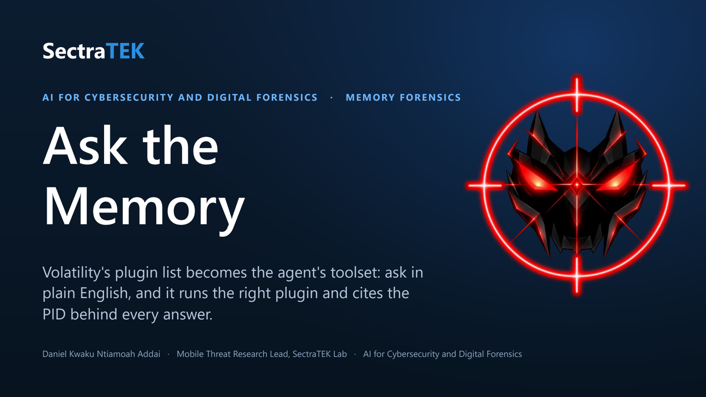
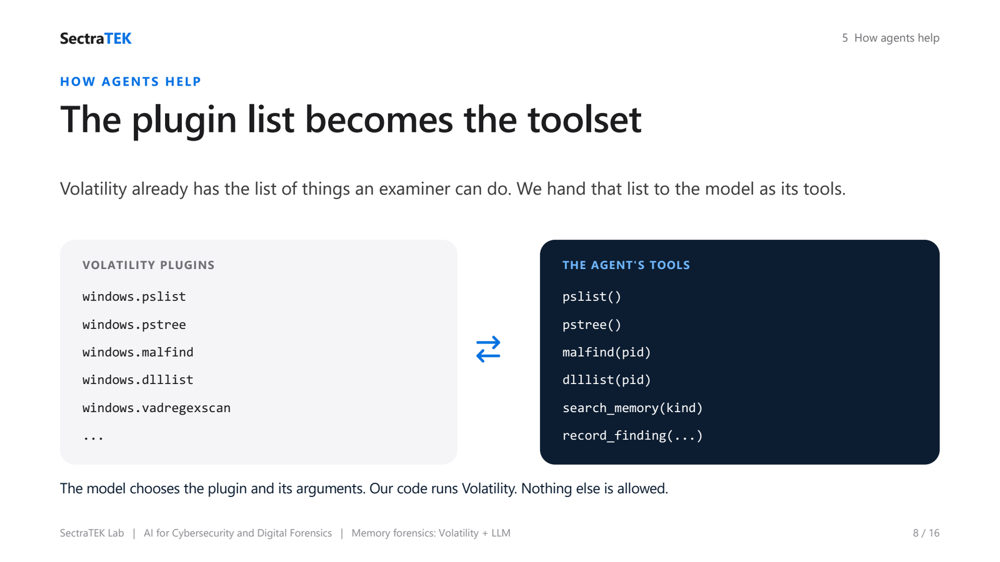
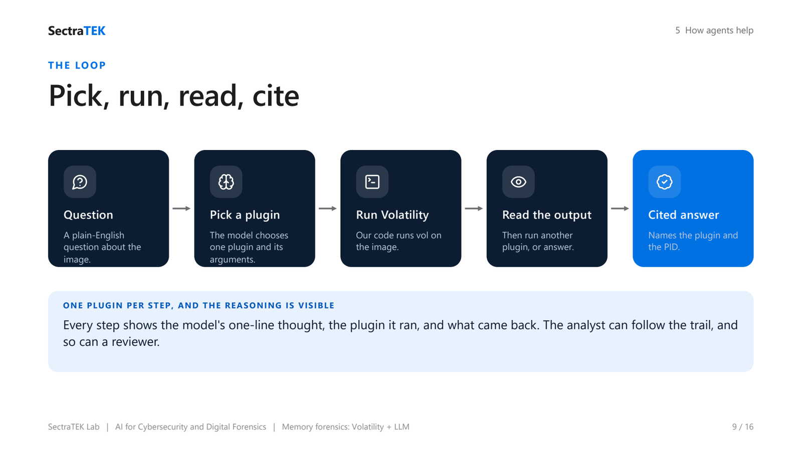
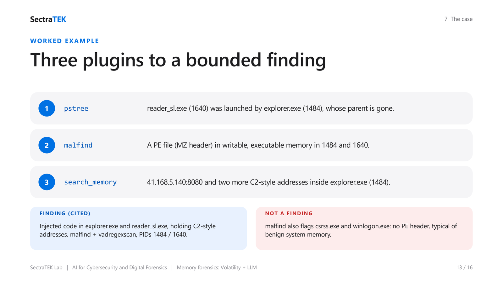

  

# Ask the Memory: A Memory-Forensics Agent over Volatility 3

> Ask a plain-English question about a memory image. An AI analyst picks the right Volatility plugin,
> runs it, reads the output, and answers, citing the plugin and the process ID behind every claim.

**Course:** AI for Cybersecurity and Digital Forensics (memory forensics)
**Technique:** A tool-using agent (ReAct) whose toolset is Volatility 3's plugin list
**Case:** Suspected compromise of a Windows XP workstation, `MF-2026-001` (real public memory image)
**Runtime:** Google Colab or any hosted Jupyter, Volatility 3, free Groq model, no local install
**Slides:** [lecture deck (PDF)](slides/SectraTEK_Memory_Forensics_Agent.pdf) : [PowerPoint](slides/SectraTEK_Memory_Forensics_Agent.pptx)

---

## Abstract

Memory forensics recovers what a computer was doing at the moment its RAM was captured: running
processes, code injected into them, and the addresses they were talking to, much of which never touches
the disk. The standard tool is **Volatility**, which answers each question with a different plugin. That
works, but it assumes the examiner already knows which of hundreds of plugins to run, and how to read
thousands of rows of output. This lab gives that plugin list to a language model **as its toolset**. The
analyst asks a question; the model picks one plugin and its arguments; the lab's code runs Volatility on
the image; the model reads the result, runs another plugin or answers, and cites the plugin and PID it
relied on. The case uses the public **Cridex** memory image, a real Windows XP banking-trojan infection with
published ground truth, so students can check every claim the AI makes against a known answer.

---

## Table of contents

1. [Background](#1-background)
2. [Problem statement](#2-problem-statement)
3. [The idea: the plugin list is the toolset](#3-the-idea-the-plugin-list-is-the-toolset)
4. [Methods: the toolset and its guardrails](#4-methods-the-toolset-and-its-guardrails)
5. [The case and the memory image](#5-the-case-and-the-memory-image)
6. [Practical: running the lab](#6-practical-running-the-lab)
7. [Worked example](#7-worked-example)
8. [Checking the AI against the ground truth](#8-checking-the-ai-against-the-ground-truth)
9. [Discussion and limits](#9-discussion-and-limits)
10. [Files in this lab](#10-files-in-this-lab)
11. [Credits and data sources](#11-credits-and-data-sources)

---

## 1. Background

A disk image shows what was stored. A memory image shows what was **running**: every process and who
started it, the DLLs each one loaded, code that malware injected into a legitimate process, open handles,
and network addresses held in memory. Much of this exists only in RAM and is lost when the machine powers
off, which is why responders capture memory first.

Volatility is the standard open-source framework for reading a memory image. An examiner runs one plugin
per question (`windows.pstree` for the process tree, `windows.malfind` for injected code, and so on), reads
the table it prints, and cross-checks with a second plugin before concluding.

## 2. Problem statement

Even a small 512 MB image of one old workstation produces a lot to read: 17 processes, 738 loaded DLLs,
1,174 file objects, and 4,451 open handles. Knowing which plugin answers which question takes training.
The tempting shortcut, asking a chatbot what is in the memory, is worse: it answers fluently and
specifically without ever running a plugin, so its diagnosis has nothing behind it.

## 3. The idea: the plugin list is the toolset

   
  <em>Volatility already lists everything an examiner can do. That list becomes the model's toolset: it chooses a plugin and its arguments, and the lab's code runs the real Volatility command.</em>

The model never sees memory directly. It can only act by choosing a plugin from a fixed list; the lab's
code runs `vol -r json -f <image> <plugin>` and hands back the result. It loops (think, run one plugin,
read the output) until it can answer, and the answer names the plugin and PID it relied on.

   
  <em>One plugin per step, with the model's one-line reasoning shown each time, so the analyst (or a reviewer) can follow the trail.</em>

## 4. Methods: the toolset and its guardrails

| Group | Tools (Volatility plugin behind each) |
|---|---|
| **Processes** | `info`, `pslist`, `pstree`, `psscan`, `psxview`, `cmdline` |
| **Code and modules** | `malfind`, `dlllist(pid)`, `ldrmodules(pid)` |
| **Objects** | `handles(pid)`, `mutantscan`, `filescan(keyword)`, `svcscan`, `hivelist`, `getsids`, `envars(pid)` |
| **Network** | `netscan` (Windows Vista and later), `search_memory` (`windows.vadregexscan`, any Windows) |
| **The case** | `case_brief`, `record_finding(finding, evidence)`, `findings_report` |

Guardrails, built into `memkit.py`:

- **Whitelist, read-only, no shell.** Only the plugins above can run; arguments are validated (a PID must be
  a number) and passed straight to Volatility, never through a shell.
- **Run once, cached.** Each plugin runs once per image; later questions reuse the cached JSON.
- **Filtered and capped.** Heavy plugins require a PID or keyword; every result is capped so the model is
  never flooded.
- **Cite or do not claim.** Every answer must name the plugin and PID. A `malfind` hit is a lead until a
  second plugin supports it.

## 5. The case and the memory image

The case brief (`case/case_brief.md`) describes a clerk whose Windows XP workstation slowed down and whose
banking session "behaved strangely" after they opened a PDF; IT captured RAM before isolating it.

The memory image is the public **Cridex** sample (`cridex.vmem`): a real infection captured in 2012 and
used for years to teach memory forensics.

| | |
|---|---|
| Download | about 40 MB (zip), 512 MB unpacked; fetched by the notebook |
| Integrity | SHA-256 of the zip and MD5 of the image are checked against pinned values (`7494f3b77db1525c1974f5380744ae46`) |
| System | Windows XP SP3, 32-bit (PAE), captured 2012-07-22 02:45 UTC |
| Tested with | Volatility 3 (2.28.2) |

**Use your own image:** set `MEMORY_IMAGE` in the notebook to its path. On Windows Vista and later, the
`netscan` network plugin also works.

## 6. Practical: running the lab

1. Click **Open in Colab** at the top. The notebook installs Volatility 3, writes the lab code, and downloads
   and verifies the image. Nothing is installed on your own computer.
2. Run Volatility **by hand** first (`windows.info`, `windows.pstree`) to see the raw tool.
3. Paste a free Groq API key when asked (create one at console.groq.com), then ask Sectra the case questions
   with `talk("...")` and watch which plugin it chooses for each.
4. Print the findings report, then compare every claim with the answer key.

For a chat window instead, open `memory_agent_ui.ipynb` (Colab prints a public link). The first plugin run
downloads Windows symbol files (about a minute); after that, answers are quick.

## 7. Worked example

   
  <em>pstree, malfind, and search_memory lead to one bounded, cited finding; malfind's hits in csrss.exe and winlogon.exe are recognised as benign.</em>

Asked *"Is there evidence of injected code, and is this machine talking to anything?"*, the agent runs:

1. `pstree`: `reader_sl.exe` (PID 1640) was launched by `explorer.exe` (PID 1484), whose parent is gone.
2. `malfind`: a PE file (MZ header) in writable, executable memory in 1484 and 1640. The 12 hits in
   `csrss.exe` and `winlogon.exe` have no PE header, which is typical of benign system memory.
3. `search_memory(kind="ip")`: `41.168.5.140:8080`, `188.40.0.138:8080`, and `125.19.103.198:8080` inside
   `explorer.exe` (1484).

Finding: injected code in explorer.exe and reader_sl.exe, holding command-and-control style addresses.
Evidence: `windows.malware.malfind` and `windows.vadregexscan`, PIDs 1484 and 1640.

## 8. Checking the AI against the ground truth

[`answer_key.md`](answer_key.md) lists the verified answer to each case question, with the plugin that
proves it. The agent never reads that file. After working the case, compare:

- Did the agent treat the csrss/winlogon `malfind` hits as findings, or recognise them as benign?
- Did it **name the malware family**? Memory shows injection and addresses; naming it "Cridex" relies on
  outside threat intelligence, which the agent should say.
- Which claims did it corroborate with a second plugin?

## 9. Discussion and limits

- **No XP network plugin.** Volatility 3's `netscan` supports Windows Vista and later only. On this XP image,
  `search_memory` finds the addresses inside the process, but memory alone cannot prove a connection
  succeeded (Volatility 2's `connscan` attributed the connection to PID 1484 in public write-ups).
- **The agent assists; the examiner decides.** It removes the typing and the plugin hunt, not the judgment.
- **Free models vary.** Re-run or rephrase if a step is missed; every claim is checkable against the cited
  plugin output.

## 10. Files in this lab

| File | What it is |
|---|---|
| `memory_agent_jupyter.ipynb` | The main lab: run Volatility by hand, then work the case with `talk("...")`. |
| `memory_agent_ui.ipynb` | The same analyst as a Gradio chat window. |
| `memkit.py` | The toolset (one tool per whitelisted plugin), the runner, guardrails, and the system prompt. |
| `memory_app.py` | The Gradio app, also runnable locally: `python memory_app.py`. |
| `agentkit.py` | The shared agent core (the think-act-observe loop), as in the other labs. |
| `case/case_brief.md` | The case: what happened, what was collected, the questions. |
| `answer_key.md` | The ground truth, for checking the AI's answers. |
| `slides/` | The lecture deck ([PDF](slides/SectraTEK_Memory_Forensics_Agent.pdf) / [PPTX](slides/SectraTEK_Memory_Forensics_Agent.pptx)). |

The memory image is downloaded at run time and is never stored in this repository.

## 11. Credits and data sources

Lab design and code by Daniel Kwaku Ntiamoah Addai, SectraTEK Lab. Memory analysis by
[Volatility 3](https://github.com/volatilityfoundation/volatility3) (Volatility Foundation, Volatility
Software License), installed from PyPI at run time. The Cridex memory image is a widely used public teaching
sample listed on the Volatility Foundation's memory-samples page; the notebook downloads it from a public
mirror and verifies it against pinned hashes. The case story is a fictional framing for the class.
