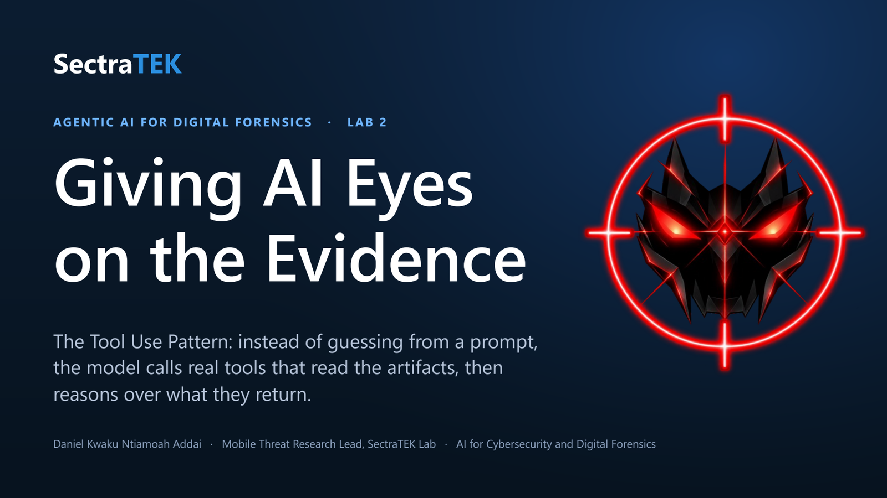
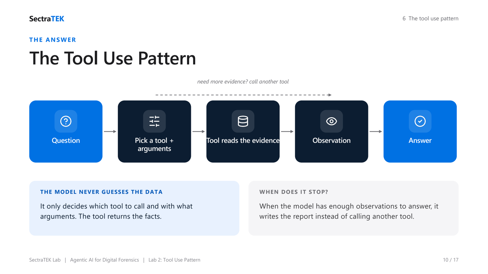
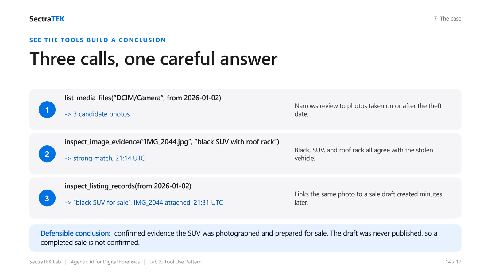

<p align="center">
  <a href="slides/SectraTEK_Lab02_ToolUse.pdf"></a>
</p>

# Lab 02: The Tool Use Pattern for Evidence Inspection

[](https://colab.research.google.com/github/danjethh/sectratek-AI-Lab/blob/main/lab02_tool_use_pattern/03_lab_notebook.ipynb)

> Stop the model from guessing. Give it tools that read the real evidence, and let it reason over
> what the tools return.

**Course:** AI for Cybersecurity and Digital Forensics - [SectraTEK AI Lab](../README.md)
**Pattern:** Tool Use (choose a tool, pass valid arguments, read the observation, reason)
**Case:** Stolen-vehicle sale preparation, `TU-2026-004`
**Runtime:** Google Colab or any hosted Jupyter, free Groq endpoint, no local install
**Slides:** [lecture deck (PDF)](slides/SectraTEK_Lab02_ToolUse.pdf) : [PowerPoint](slides/SectraTEK_Lab02_ToolUse.pptx)

---

## Abstract

This lab introduces the **Tool Use Pattern**: giving a language model a set of functions it can call,
so that the facts in its answer come from reading real artifacts rather than from guessing. The
student investigates a recovered phone to decide whether a stolen black SUV was photographed and
prepared for an online sale. Three local tools read the gallery, inspect a single image against the
case description, and retrieve saved sale drafts. The student runs the tools by hand first (Part A),
then hands the same tools to a `ToolAgent` that selects the calls on its own (Part B). The lab's core
discipline is to ground every claim in a tool output and to label the conclusion honestly as
confirmed, likely, or unconfirmed, with explicit limits. It builds directly on Lab 01: where
Reflection improved how the model wrote, Tool Use improves what the model can actually see.

---

## Table of contents

1. [Background](#1-background)
2. [Problem statement](#2-problem-statement)
3. [Gaps this lab addresses](#3-gaps-this-lab-addresses)
4. [The solution: the Tool Use Pattern](#4-the-solution-the-tool-use-pattern)
5. [Methods and approach](#5-methods-and-approach)
6. [The case: TU-2026-004](#6-the-case-tu-2026-004)
7. [Practical: running the lab](#7-practical-running-the-lab)
8. [Worked example](#8-worked-example)
9. [Discussion](#9-discussion)
10. [Learning outcomes and assessment](#10-learning-outcomes-and-assessment)
11. [Files in this lab](#11-files-in-this-lab)
12. [Credits](#12-credits)

---

## 1. Background

A forensic conclusion is only as good as the evidence under it. In Lab 01 the model reasoned over text
that was pasted into its prompt. That works for a small case, but it has a hard limit: the model can
only reason about what it was handed, and when asked about anything else it will **fabricate** a
plausible answer. A model has no eyes on the device. Asked "which photo shows the stolen vehicle?",
a plain model will invent a filename and a timestamp that sound right and are entirely made up.

The **Tool Use Pattern** removes the guessing. Instead of asking the model what the evidence shows,
we give it **tools**, ordinary functions that read the actual artifacts, and let the model decide
which tool to call and with what arguments. The model never touches the data directly; it requests a
named tool, the tool reads the evidence, and the model reasons over the returned observation.

---

## 2. Problem statement

> **How do we let an AI help investigate a phone without letting it invent the facts it reports?**

The case makes the stakes concrete. A black SUV is stolen; a recovered phone holds photos, image
metadata, automatic vehicle detections, and saved sale drafts. The right answer requires connecting a
specific photo to a specific sale draft by timestamp and content. A model guessing from a prompt
cannot do this safely: it will confidently name files and times that do not exist. The model needs a
disciplined, auditable way to **read** the evidence, not imagine it.

---

## 3. Gaps this lab addresses

| Gap | Without tools | With tools |
|---|---|---|
| **Fabricated specifics** | The model invents filenames, timestamps, and events. | Every value comes from a tool that read a real record. |
| **No audit trail** | You cannot check where a claim came from. | Each claim maps to a named tool call and its output. |
| **Overclaimed outcomes** | "The vehicle was sold." | The draft was never published, so a completed sale is `unconfirmed`. |
| **Opaque agent magic** | A framework hides which tools ran. | Part A runs the tools by hand before Part B hands them to an agent. |

---

## 4. The solution: the Tool Use Pattern

<p align="center">
  <br>
  <sub><em>The Tool Use loop: the model picks one tool and its arguments, the tool reads the real artifact, the model observes the result, and only then answers.</em></sub>
</p>


```
            +----------------- need more evidence? call another tool -----------------+
            v                                                                          |
 Question -> [ Pick a tool + arguments ] -> [ Tool reads the evidence ] -> [ Observation ] -+ -> Answer
                        (the model decides)            (real function)       (back to model)
```

The model's only job is to choose a tool and its arguments. The facts always come from the tools. The
loop repeats until the model has enough observations to answer, at which point it writes the report
instead of calling another tool.

**Under the hood.** The model does not call a function directly. It writes a small structured request:

```xml
<tool_call>
{"name": "inspect_image_evidence",
 "arguments": {"file_name": "IMG_2044.jpg", "case_description": "black SUV with roof rack"}}
</tool_call>
```

The agent reads that block, validates the argument types against the tool's signature, runs the real
Python function on the evidence, and feeds the result back to the model.

---

## 5. Methods and approach

The notebook is in two parts, by design.

- **Part A: call the tools yourself.** You define the three tools, inspect their signatures, and run
  the core sequence directly, inspecting the strong candidate image and a weaker one so you can see
  both supporting and limiting evidence. Then a single model call writes a report **from the evidence
  you already gathered**, so it cannot invent facts.
- **Part B: hand the tools to `ToolAgent`.** The agent receives the same three tools and the same case
  question, and now chooses the calls itself. You watch each `Using Tool:` line and its result, then
  judge whether the agent picked the right tools, inspected the right image, and stayed inside the
  evidence.

**The three tools.**

| Tool | Arguments | What it returns |
|---|---|---|
| `list_media_files` | `root`, `date_from` | Candidate photos in a folder, on or after a date. |
| `inspect_image_evidence` | `file_name`, `case_description` | One photo's metadata and vehicle detection, with a match score. |
| `inspect_listing_records` | `date_from` | Saved sale drafts and the photo each one attaches. |

Core sequence: `list_media_files` -> `inspect_image_evidence` -> `inspect_listing_records`.

**Runtime.** The notebook connects to a free, OpenAI-compatible endpoint (Groq by default; the setup
cell picks the first free model on its `PREFERRED` list, currently `qwen/qwen3.8-27b`, which follows
the `<tool_call>` text format this agent uses). The key is entered with
a hidden prompt and never saved. The notebook writes the six case artifacts to a local `data/` folder
itself, so it runs standalone in Colab with no clone and no install. See
[../docs/GROQ_SETUP.md](../docs/GROQ_SETUP.md).

---

## 6. The case: TU-2026-004

- **Device:** Samsung Galaxy S23, Android 14
- **Acquisition:** Magnet AXIOM, logical plus media export; image hash recorded in the manifest
- **Reported stolen:** a black SUV with a roof rack, on 2 January 2026
- **The question:** does the phone contain confirmed, likely, or unconfirmed evidence that the stolen
  SUV was photographed and prepared for an online sale after 2 January 2026?

### The artifacts (`data/`)

| File | Contents |
|---|---|
| `artifact_manifest.json` | Case, device, and integrity metadata |
| `media_index.csv` | Recovered image files: path, creation time, size, folder |
| `image_metadata.csv` | Per-image capture and edit times, GPS, camera model |
| `vehicle_detections.csv` | Detected color, body type, roof rack, and confidence per image |
| `listing_drafts.json` | Saved sale-listing drafts, attached images, and publication status |
| `chain_of_custody.csv` | Handling and hash-verification log |

### The key chain

`IMG_2044.jpg` is a strong match (black, SUV, roof rack, captured 21:14 UTC) and is attached to a
draft titled "black SUV for sale" created at 21:31 UTC. The draft's `published_at_utc` is `null`: it
was never posted. Preparation for sale is **confirmed**; a completed sale is **unconfirmed**.

---

## 7. Practical: running the lab

1. Click the **Open in Colab** badge at the top of this page.
2. Run **Part 0** (setup): install the client, connect to Groq (paste a free key), write the case files,
   and load the tool framework.
3. Run **Part A**: define and call the three tools yourself, then have the model write a report from the
   gathered evidence.
4. Run **Part B**: hand the tools to `ToolAgent` and watch it choose the calls.
5. Write your own five-part report and the workflow comparison.
6. Save and submit the notebook.

No local install is required. If a model is ever retired, the setup cell uses the next one on its `PREFERRED` list and prints which it chose.

---

## 8. Worked example

<p align="center">
  <br>
  <sub><em>Three tool calls build one careful answer: each reads a real artifact, so the conclusion cites evidence instead of guessing.</em></sub>
</p>


Three calls turn records into a conclusion:

| Call | Output | Why it matters |
|---|---|---|
| `list_media_files("DCIM/Camera", from 2026-01-02)` | 3 candidate photos | Narrows review to photos on or after the theft date. |
| `inspect_image_evidence("IMG_2044.jpg", "black SUV with roof rack")` | strong match, 21:14 UTC | Black, SUV, and roof rack all agree with the stolen vehicle. |
| `inspect_listing_records(from 2026-01-02)` | "black SUV for sale", IMG_2044 attached, 21:31 UTC | Links the same photo to a sale draft minutes later. |

**Overstated conclusion:** "The phone shows the seller posted the stolen vehicle for sale online."

**Evidence-bounded conclusion:** "The phone contains confirmed evidence that a black SUV matching the
stolen vehicle was photographed on 2 January 2026 and attached to a sale draft created later that
evening. The records do not confirm that the listing was posted or that the vehicle was sold."

---

## 9. Discussion

**Tools make the model auditable.** The value is not only accuracy; it is that every fact now has a
traceable source. A reviewer can replay the exact calls and check each observation.

**The agent still is not the examiner.** `ToolAgent` may omit a needed call, inspect the wrong image,
or overclaim in its write-up. Part B is deliberately a chance to catch that. The conclusion label,
confirmed, likely, or unconfirmed, is the examiner's judgment, and it is where a human stays in charge.

**Confirmed is not complete.** The hardest habit this lab teaches is respecting the boundary between
preparation and completion. The evidence confirms the vehicle was prepared for sale; it cannot confirm
a sale that the artifacts never record.

---

## 10. Learning outcomes and assessment

By the end of this lab a student can:

1. Select the right tool and valid arguments for each evidence question.
2. Read tool observations rather than guessing from the model.
3. Connect timestamps, vehicle attributes, and listing records into a defensible chain.
4. Label a conclusion confirmed, likely, or unconfirmed, with explicit limits.
5. Evaluate when a `ToolAgent` tool choice, argument, or interpretation should be corrected or rejected.

**Required report (both Part A and Part B):** tool-call log; strongest timestamp evidence; strongest
vehicle-match evidence; a conclusion label with a confidence per major claim; and an explicit evidence
mapping with limits. Instructor guidance is in [../docs/INSTRUCTOR_GUIDE.md](../docs/INSTRUCTOR_GUIDE.md).

---

## 11. Files in this lab

| Path | What it is |
|---|---|
| `03_lab_notebook.ipynb` | The hosted (Colab/Groq) student notebook |
| `data/` | The six synthetic case artifacts |
| `slides/SectraTEK_Lab02_ToolUse.pptx` | The lecture deck for this lab |
| `README.md` | This document |

---

## 12. Credits

The case design and lab concept are adapted from **frankwxu/agentic-AI4-forensics**
(https://github.com/frankwxu/agentic-AI4-forensics). The tool framework (`Tool`, `@tool`, `ToolAgent`)
is adapted from **The Neural Maze's agentic-patterns-course**
(https://github.com/neural-maze/agentic-patterns-course), MIT License; see
[../THIRD_PARTY_NOTICES.md](../THIRD_PARTY_NOTICES.md). The hosted adaptation, notebook, slides, and
documentation are by Daniel Kwaku Ntiamoah Addai, SectraTEK Lab.
