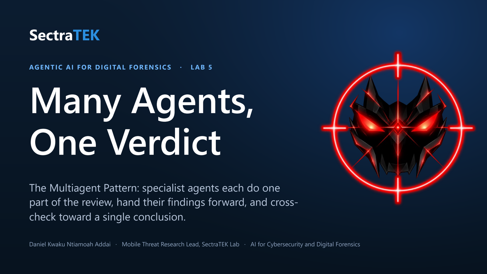
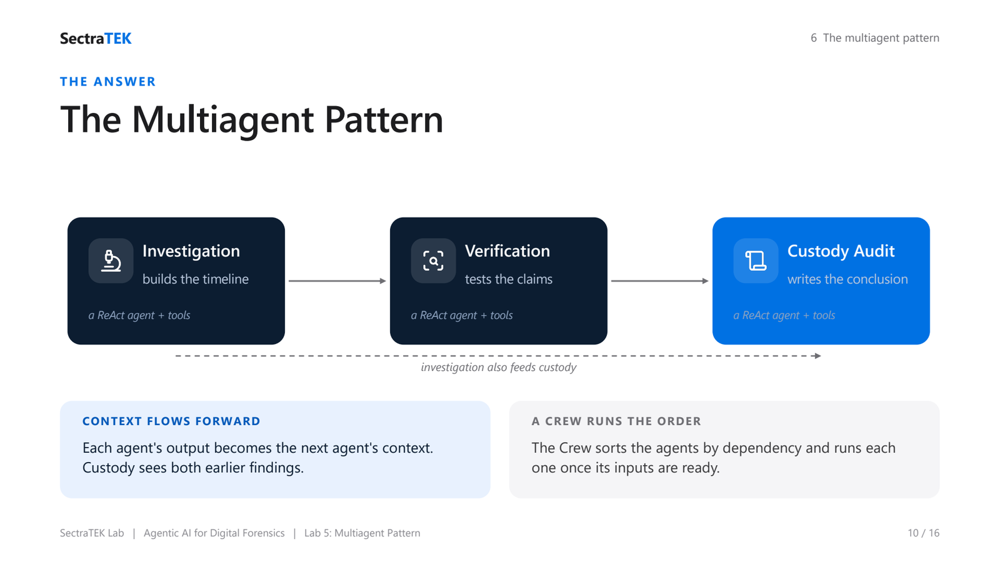
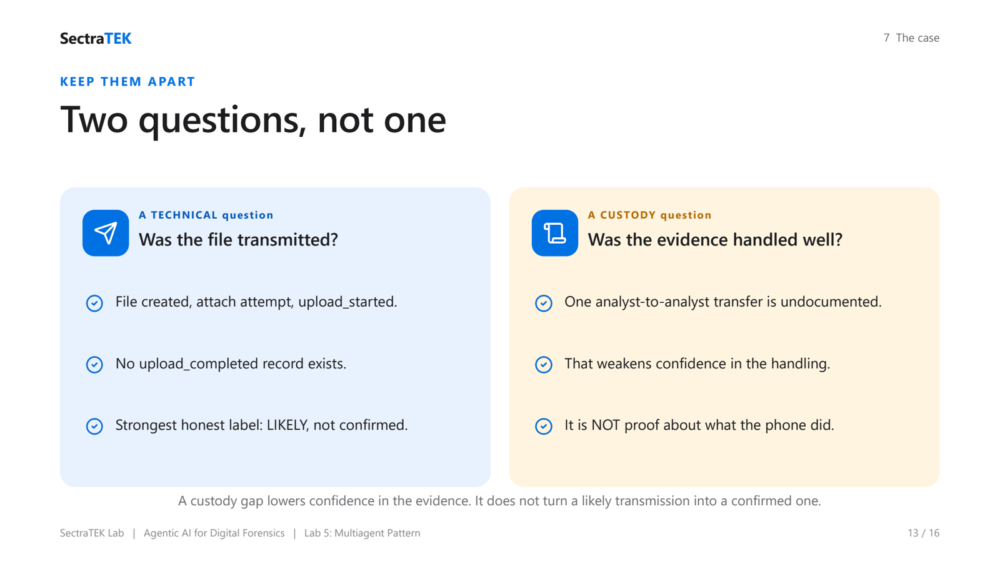

<p align="center">
  <a href="slides/SectraTEK_Lab5_Multiagent.pdf"></a>
</p>

# Lab 05: The Multiagent Pattern for Evidence and Custody Review

[](https://colab.research.google.com/github/danjethh/sectratek-AI-Lab/blob/main/lab05_multiagent_pattern/03_lab_notebook.ipynb)

> Split one review across specialist agents that each do one part and check one another, so the final
> conclusion is built by independent roles rather than a single agent grading its own work.

**Course:** AI for Cybersecurity and Digital Forensics - [SectraTEK AI Lab](../README.md)
**Pattern:** Multiagent (specialist roles + handoff + a Crew that orders them)
**Case:** File transmission and chain-of-custody review, `MA-2026-022`
**Runtime:** Google Colab or any hosted Jupyter, free Groq endpoint, no local install
**Slides:** [lecture deck (PDF)](slides/SectraTEK_Lab5_Multiagent.pdf) : [PowerPoint](slides/SectraTEK_Lab5_Multiagent.pptx)

---

## Abstract

This lab introduces the **Multiagent Pattern**: several specialist agents each take one part of a
review, hand their output forward as context, and challenge the earlier findings before a single
conclusion is written. Three agents examine one case: an **InvestigationAgent** reconstructs the
technical timeline, an **EvidenceVerificationAgent** tests those claims against the records, and a
**CustodyAuditAgent** reviews how the evidence was handled and writes the final, confidence-bounded
conclusion. The case is built so that two different questions must be kept apart: whether a patient
file was transmitted (a technical question, answered **likely** because the records show an upload
*started* but not *completed*) and whether a gap in the chain-of-custody record weakens confidence (an
evidence-handling question that must not be mistaken for proof about the phone). Students run the team
one agent at a time (Part A), then let a **Crew** orchestrate the same team in dependency order (Part
B). It is the capstone pattern: each agent is itself a ReAct agent with tools (Lab 3), so the course's
ideas compose.

---

## Table of contents

1. [Background](#1-background)
2. [Problem statement](#2-problem-statement)
3. [Gaps this lab addresses](#3-gaps-this-lab-addresses)
4. [The solution: the Multiagent Pattern](#4-the-solution-the-multiagent-pattern)
5. [Methods and approach](#5-methods-and-approach)
6. [The case: MA-2026-022](#6-the-case-ma-2026-022)
7. [Practical: running the lab](#7-practical-running-the-lab)
8. [Worked example: two questions, kept apart](#8-worked-example-two-questions-kept-apart)
9. [Discussion](#9-discussion)
10. [Learning outcomes and assessment](#10-learning-outcomes-and-assessment)
11. [Files in this lab](#11-files-in-this-lab)
12. [Credits](#12-credits)

---

## 1. Background

Forensic labs do not let one person examine evidence, review that examination, and certify the handling
all alone. They separate duties on purpose, so that one person's blind spot does not quietly become the
finding. The **Multiagent Pattern** gives a model team the same separation: distinct agents with narrow
roles, each with its own task and its own tools, passing findings forward and challenging what came
before.

It is also where the course's patterns compose. Each agent here is a **ReAct agent** (Lab 3) that
reasons and calls evidence tools inside its own turn. The new element is coordination: a **handoff** of
context between agents, and a **Crew** that runs them in dependency order.

---

## 2. Problem statement

> **How do we get an independent check on an AI's forensic conclusion, instead of one agent that both
> makes a claim and confirms it?**

A single agent asked to settle this case will tend to produce the claim and its own check from the same
reasoning, blend the transmission question with the custody question, and slide from "upload started" to
"transmitted." The case needs genuinely separate roles: one to build the technical account, one to test
it against the records, and one to review evidence handling, so the final label is earned, not
self-certified.

---

## 3. Gaps this lab addresses

| Gap | With one agent | With a team |
|---|---|---|
| **Self-grading** | The claim and its check share one blind spot. | A separate role tests the claim independently. |
| **Blended questions** | Transmission and custody get mixed. | Technical and custody roles stay distinct. |
| **Attempt read as completion** | "upload started" becomes "transmitted." | Verification stops the rating at "likely." |
| **Lost reasoning** | One answer, little traceability. | Each handoff carries the earlier reasoning forward. |

---

## 4. The solution: the Multiagent Pattern

<p align="center">
  <br>
  <sub><em>The Multiagent pattern: specialist agents each do one part of the review - investigation, verification, custody audit - and hand their findings forward to a single, cross-checked verdict.</em></sub>
</p>


```
   InvestigationAgent ----> EvidenceVerificationAgent ----> CustodyAuditAgent ----> Final conclusion
     (builds timeline)        (tests the claims)              (audits handling,
            |                                                  writes the verdict)
            +--------------------- also feeds ------------------------^
```

- Each agent has a **role** (backstory), a **task**, an **output format**, and its **own tools**.
- Dependencies are declared with `>>`: `InvestigationAgent >> EvidenceVerificationAgent` means
  verification depends on investigation and receives its output as context. CustodyAudit depends on
  **both** earlier agents.
- A **Crew** performs a topological sort of this graph and runs each agent once its inputs are ready,
  passing outputs forward as context.

Role boundaries are enforced by tools: the investigation and verification agents hold the technical
tools; the custody agent holds only the chain-of-custody tool.

---

## 5. Methods and approach

The notebook is in two parts, by design.

- **Part A: run the team by hand.** You define the evidence tools, build the three agents and wire their
  dependencies, then run them one at a time. Before each later agent runs, you print the **context** it
  received, so you can see investigation's output flow into verification, and both flow into custody.
- **Part B: orchestrate with `Crew`.** You rebuild the same team inside a `Crew`, print the dependency
  graph and run order, and let the crew run the whole workflow. The case logic is identical; only the
  orchestration changes.

**The agents and their tools.**

| Agent | Tools | Hands forward |
|---|---|---|
| `InvestigationAgent` | device, file, messaging, network | a draft timeline and transmission assessment |
| `EvidenceVerificationAgent` | the same technical tools | a revised rating (likely, not confirmed) |
| `CustodyAuditAgent` | the chain-of-custody tool | the final confidence-bounded conclusion |

**Runtime.** The notebook connects to a free, OpenAI-compatible endpoint (Groq by default, model
`llama-3.3-70b-versatile`). The key is entered with a hidden prompt and never saved. The notebook writes
the six case artifacts to a local `data/` folder itself, so it runs standalone in Colab with no clone
and no install. See [../docs/GROQ_SETUP.md](../docs/GROQ_SETUP.md).

---

## 6. The case: MA-2026-022

- **Device:** Motorola Edge 2024, Android 14
- **Setting:** a public-health outreach phone, left unattended during a vaccination event
- **File of interest:** `patients_contacts.png`
- **Incident window (UTC):** 18:35:00 to 19:10:00

### Observed event sequence (UTC)

| Time | What the records show |
|---|---|
| 18:35:02 | device locked (start of the unattended interval) |
| 18:44:11 | `patients_contacts.png` created on the device |
| 18:45:02 | SecureChat attach attempt with that file |
| 18:45:07 | network `upload_started` (48,211 bytes out) |
| 19:10:08 | device unlocked |
| (later) | an analyst review begins with no documented transfer from the prior handler |

### The artifacts (`data/`)

| File | Contents |
|---|---|
| `artifact_manifest.json` | Case, device, and integrity metadata |
| `device_state.csv` | Lock and unlock records bounding the unattended interval |
| `file_events.csv` | Creation and hash of `patients_contacts.png` |
| `messaging_events.csv` | The SecureChat attachment attempt |
| `network_events.csv` | The `upload_started` record (no completion record) |
| `chain_of_custody.csv` | Handling log, missing one analyst-to-analyst transfer |

---

## 7. Practical: running the lab

1. Click the **Open in Colab** badge at the top of this page.
2. Run **Part 0** (setup): install the client, connect to Groq (paste a free key), write the case files,
   and load the multiagent framework.
3. Run **Part A**: define the tools, build the three agents, and run them in order, reading the context
   each one receives.
4. Run **Part B**: rebuild the team in a `Crew`, print the dependency graph, and run the crew.
5. Write your own final judgment.
6. Save and submit the notebook.

No local install is required. If the default model name is ever retired, the setup cell prints the
models available on your key.

---

## 8. Worked example: two questions, kept apart

<p align="center">
  <br>
  <sub><em>Two questions, kept apart: the technical question (was the file transmitted?) and the custody question (was the evidence handled well?) are answered by separate roles, so neither masks the other.</em></sub>
</p>


| | Was the file transmitted? (technical) | Was the evidence handled well? (custody) |
|---|---|---|
| Evidence | File created, attach attempt, `upload_started` (48 KB). | One analyst-to-analyst transfer is undocumented. |
| Missing | No `upload_completed` record. | A complete, unbroken handling chain. |
| Answer | **Likely**, not confirmed. | Confidence in handling is **weakened**. |

**Overstated conclusion:** "There was an upload and the custody log looks fine, so the patient file was
transmitted."

**Evidence-bounded conclusion:** "The records show the file was created, selected as an attachment, and
that an upload started; they do not show an upload completed, so transmission is **likely**, not
confirmed. Separately, the chain-of-custody record is missing a transfer between analysts, which weakens
confidence in evidence handling but is not proof about whether the phone completed the transmission."

A custody gap lowers confidence in the evidence; it does not turn a likely transmission into a confirmed
one.

---

## 9. Discussion

**Independence is the value.** Adding agents is not the point; the independent check between them is. A
separate verification role, with its own look at the records, catches the "upload started equals
transmitted" overreach that a single agent would carry through.

**Two questions, never blurred.** The hardest discipline is keeping the technical transmission question
and the evidence-handling question apart. A custody gap is a handling issue; it changes how much you
trust the evidence, not what the phone did.

**The capstone.** This pattern composes the whole course: each agent is a ReAct agent (Lab 3) with tools
(Lab 2), capable of reflection (Lab 1) and used within a planned workflow (Lab 4). Across all five, the
constant is the same: the AI is an aid to an examiner, never the examiner.

---

## 10. Learning outcomes and assessment

By the end of this lab a student can:

1. Assign related forensic subtasks to specialized agents with clear role boundaries.
2. Explain how earlier agent outputs become context for later agents.
3. Compare and reconcile conflicting outputs from investigation, verification, and custody roles.
4. Evaluate whether the evidence-handling record supports or weakens confidence in a technical finding.
5. Produce an evidence-cited conclusion labeled `confirmed`, `likely`, or `unconfirmed`, with the
   remaining uncertainty stated.

**Required judgment:** a transmission label with its technical basis (the `upload_started` vs
`upload_completed` point); the custody impact, kept separate from the phone question; and the remaining
uncertainty. Instructor guidance is in [../docs/INSTRUCTOR_GUIDE.md](../docs/INSTRUCTOR_GUIDE.md).

---

## 11. Files in this lab

| Path | What it is |
|---|---|
| `03_lab_notebook.ipynb` | The hosted (Colab/Groq) student notebook |
| `data/` | The six synthetic case artifacts |
| `slides/SectraTEK_Lab5_Multiagent.pptx` | The lecture deck for this lab |
| `README.md` | This document |

---

## 12. Credits

The case design and lab concept are adapted from **frankwxu/agentic-AI4-forensics**
(https://github.com/frankwxu/agentic-AI4-forensics). The multiagent framework (`Agent`, `Crew`, built on
`ReactAgent` and the tool wrapper) is adapted from **The Neural Maze's agentic-patterns-course**
(https://github.com/neural-maze/agentic-patterns-course), MIT License; see
[../THIRD_PARTY_NOTICES.md](../THIRD_PARTY_NOTICES.md). The hosted adaptation, notebook, slides, and
documentation are by Daniel Kwaku Ntiamoah Addai, SectraTEK Lab.
