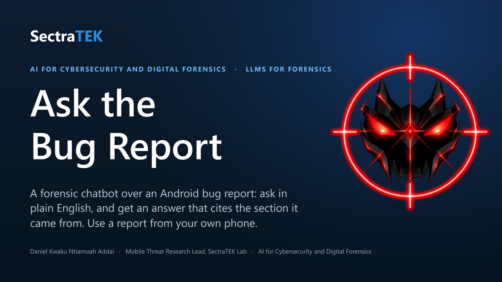
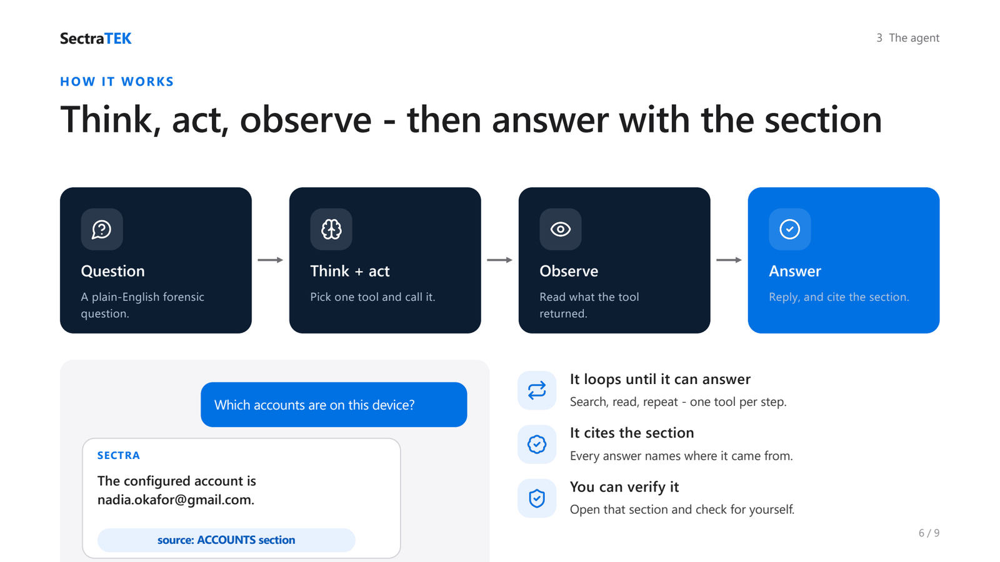
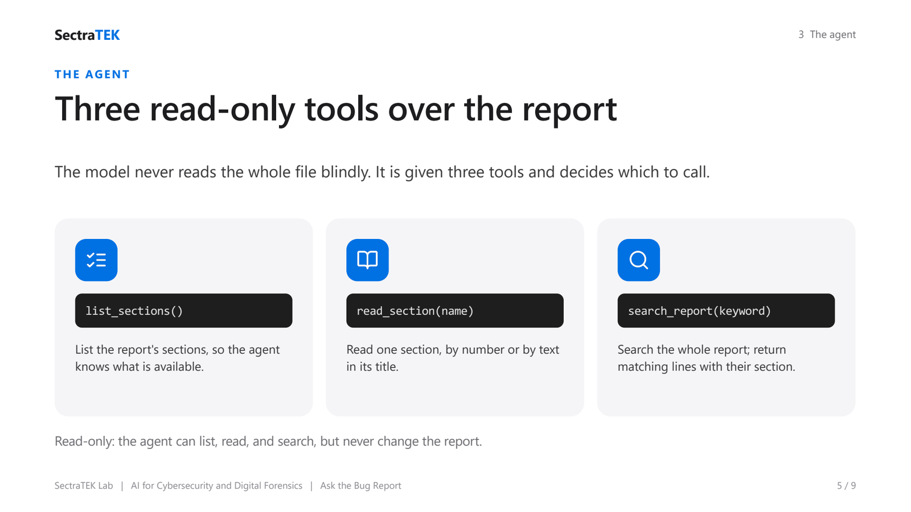

<p align="center">
  <a href="slides/SectraTEK_BugReport_Agent.pdf"></a>
</p>

# Lab 08: Ask the Bug Report, a forensic chatbot over `adb bugreport`

[](https://colab.research.google.com/github/danjethh/sectratek-AI-Lab/blob/main/lab08_llm_bug_report_chatbot/bugreport_chatbot_ui.ipynb)

> A chatbot that answers plain-English questions about an Android **bug report**, grounded in the report
> and citing the section it used. Students can use a bug report from **their own phone**.

**Course:** AI for Cybersecurity and Digital Forensics
**Technique:** A tool-using agent (ReAct) over a sectioned text report
**Runtime:** Google Colab or local, free Qwen via OpenRouter (or local Ollama), no heavy install
**Slides:** [lecture deck (PDF)](slides/SectraTEK_BugReport_Agent.pdf) : [PowerPoint](slides/SectraTEK_BugReport_Agent.pptx)

---

## Why a bug report

A full phone extraction is large and needs special tooling. An Android **bug report** is much lighter:
it is a single text file (the output of `adb bugreport`) split into labelled sections, such as device
properties, installed packages, battery, Wi-Fi, accounts, and the system log. Because it is just text and
any student can generate one from their own device, it is an ideal, low-friction way to practise asking a
language model forensic questions and getting grounded, cited answers.

## What it does

You ask a question in plain English. A lightweight **Qwen** model, given three read-only tools over the
report, decides how to find the answer - usually by searching the report or reading the right section -
and replies with the answer **and the section it came from**. It is the same agent idea as the device-image
lab (`../lab07_llm_android_image_agent/`), pointed at a bug report instead of a filesystem.

<p align="center">
  <br>
  <sub><em>The same think-act-observe loop as the device-image lab: the model picks one tool, reads what it returns, and repeats until it can answer - citing the section it used.</em></sub>
</p>

**The three tools:**

| Tool | What it does |
|---|---|
| `list_sections()` | List the report's sections (device info, packages, battery, Wi-Fi, accounts, log, ...). |
| `read_section(name)` | Read one section, by number or by text in its title. |
| `search_report(keyword)` | Search the whole report for a keyword; returns the matching lines with their section. |

<p align="center">
  <br>
  <sub><em>Three read-only tools: list the sections, read one, or search the whole report. The model chooses which to call; the code runs it.</em></sub>
</p>

## Getting a bug report from a real phone

1. On the phone: enable **Developer Options** (tap Build number 7 times), then turn on **USB debugging**.
2. On a computer with the Android platform tools: connect the phone and run
   ```
   adb bugreport mybugreport
   ```
   This produces `mybugreport.zip` (or a `.txt`). Upload that into the chatbot.

A **synthetic sample** (`sample_bugreport.txt`) is bundled so everything works before you have your own.
Every value in the sample is fictional.

## Two ways to run it

| File | What it is |
|---|---|
| `bugreport_chatbot_ui.ipynb` | **UI version** - launches a Gradio chat window with a file-upload box (Colab gives a public link). |
| `bugreport_chatbot_jupyter.ipynb` | **Jupyter version** - call `ask("...")` in a cell and read the agent's reasoning and cited section. |
| `bugreport_app.py` | The Gradio app as a script, to run locally: `python bugreport_app.py`. |
| `bugkit.py` | The bug-report tools and agent wiring (imported by the app and notebooks). |
| `agentkit.py` | The shared agent core (model connection, the think-act-observe loop). |
| `sample_bugreport.txt` | The bundled synthetic sample report. |
| `slides/` | The lecture deck for this lab ([PDF](slides/SectraTEK_BugReport_Agent.pdf) / [PPTX](slides/SectraTEK_BugReport_Agent.pptx)). |

## Questions to try

- *What phone model and Android version is this?*
- *Which accounts are configured on this device?*
- *Which apps are installed?*
- *What is the battery level?*
- *What Wi-Fi networks are saved?*
- *Are there any errors or crashes in the system log?*

## Running locally with no API key (Ollama)

Install [Ollama](https://ollama.com), run `ollama pull qwen3:8b`, then set `PROVIDER=ollama` (in the
notebook or as an environment variable) before launching. Nothing leaves your machine.

## A note on safety and scope

The agent's tools are **read-only**: it can list, read, and search the report, but never change it. The
model chooses which tool to run; our code runs it. Answers are grounded in the report and cite their
section, so you can always open that section and check. All sample data is synthetic.

## Credits

Lab design and code by Daniel Kwaku Ntiamoah Addai, SectraTEK Lab. The idea of pointing a small local
model at a whole Android artifact and asking a plain-English question is due to Frank Xu. Driven by an
open-source **Qwen** model via a free, OpenAI-compatible endpoint (OpenRouter) or local Ollama.
