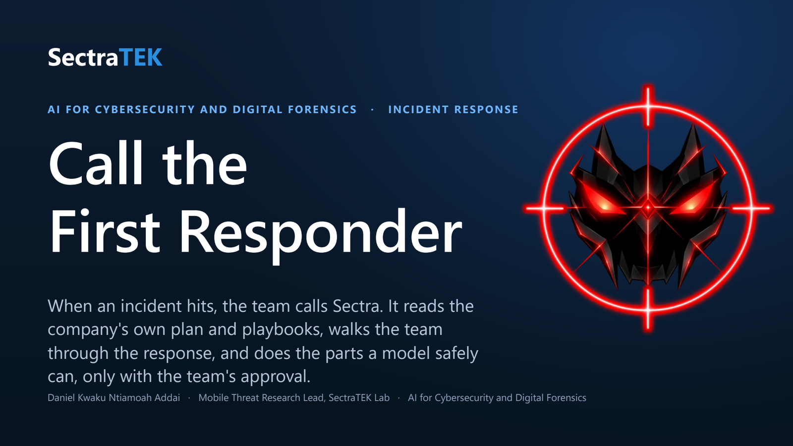
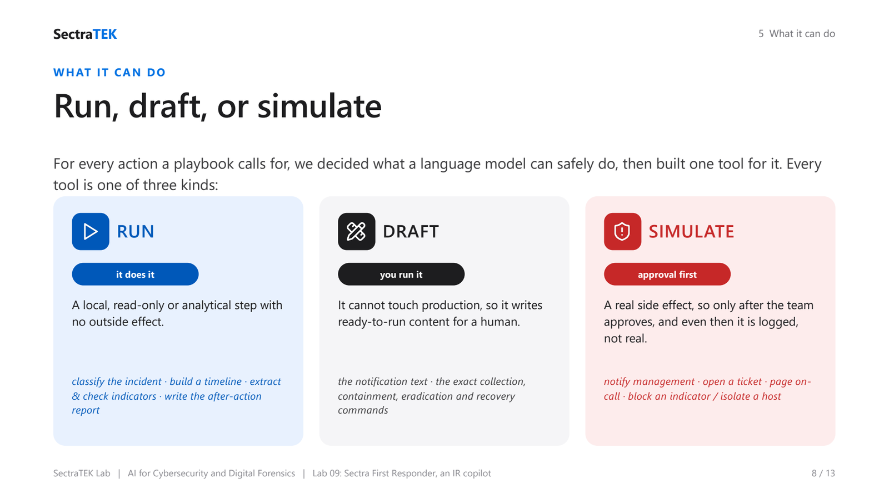
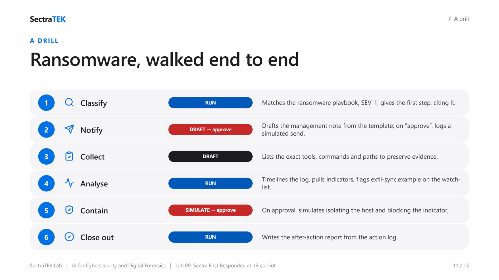

  

# Lab 09: Sectra First Responder, an Incident-Response Chatbot over your Plan and Playbooks

> When an incident hits, the team calls **Sectra**. They say what they think is happening; Sectra walks
> them through the response from the company's **IR plan and playbooks**, drafts the management
> notification (and only "sends" it - simulated - once the team approves), recommends the exact
> collection commands, and reads back the artifacts the team uploads. Every step cites the playbook.

**Course:** AI for Cybersecurity and Digital Forensics
**Technique:** A retrieval-grounded, tool-using agent with a human in the loop
**Runtime:** Google Colab or any hosted Jupyter, free Groq model (same key as Labs 01-06), no local install (Ollama optional)
**Slides:** [lecture deck (PDF)](slides/SectraTEK_Lab09_FirstResponder.pdf) : [PowerPoint](slides/SectraTEK_Lab09_FirstResponder.pptx)

---

## How it is built: one tool per IR action

Just as the Sectra DF agent walks a device image with a small fixed toolset, this copilot walks an
**incident**. We took a comprehensive IR lifecycle (NIST SP 800-61 / SANS: *identify -> notify ->
collect -> analyse -> contain -> eradicate -> recover -> after-action*) and, for every action a
playbook typically calls for, decided what a language model can safely do, then built one tool per
action. Each tool is one of three kinds:

- **RUN** - Sectra does it itself: a local, read-only or analytical step with no external effect.
- **DRAFT** - Sectra can't touch production, so it produces ready-to-run content for a human.
- **SIMULATE** - an action with a side effect; Sectra only does it **after the team approves**, and
  even then it is logged, never real.

   
  <em>Every action a playbook calls for is classified RUN (Sectra does it), DRAFT (it writes it for a human), or SIMULATE (only after the team approves, and only ever logged).</em>

| Phase | Tools | Kind |
|---|---|---|
| **Knowledge** | `list_playbooks`, `search_playbooks`, `read_playbook`, `classify_incident` | RUN (read-only) |
| **Notify / coordinate** | `draft_notification` · `notify`, `open_ticket`, `page_oncall` | DRAFT · SIMULATE (gated) |
| **Guidance** | `recommend_collection`, `recommend_containment`, `recommend_eradication`, `recommend_recovery` | DRAFT |
| **Containment action** | `contain` (isolate_host / disable_account / block_ioc) | SIMULATE (gated) |
| **Evidence analysis** | `list_evidence`, `read_evidence`, `search_evidence`, `run_sql`, `build_timeline`, `extract_iocs`, `check_indicators` | RUN (read-only) |
| **ISMS / ISO 27001 context** | `lookup_asset`, `list_assets`, `lookup_risk`, `check_policy` | RUN (read-only) |
| **Post-incident** | `after_action_report` | RUN |

When the team names a host or system (for example *the finance workstation*), Sectra looks it up in the
company's **ISO 27001 asset register** for its criticality, classification, owner, and RTO, so severity
and recovery priority match the business value of the asset, and uses `check_policy` to keep its guidance
inside the company's own ISMS policies (classification, breach notification, evidence handling).

Sectra reasons out loud (one short thought per step), uses exactly one tool per step, and cites the
plan/playbook section behind every instruction - the same discipline as the DF agent.

## A typical drill

1. **Team:** "We think we have ransomware on a finance workstation."
2. **Sectra** `classify_incident` -> ransomware, SEV-1; tells the team the first step (isolate, do
   **not** power off), citing the playbook.
3. **Sectra** offers to notify management: `draft_notification` pulls the template, then it **asks to
   approve**. On "approve" -> `notify(approved=true)` logs a **simulated** send (nothing real).
4. **Sectra** `recommend_collection` -> the exact tools, commands, and paths from the playbook.
5. Team uploads `security_events.log` / `dns_queries.csv`. Sectra **runs** `build_timeline` (orders
   the brute-force -> shadow-copy deletion -> log-clear sequence), `extract_iocs` + `check_indicators`
   (flags `exfil-sync.example`, `su.exe`, `SysUpdateSvc` against the watch-list).
6. **Sectra** `recommend_containment` / `recommend_eradication` / `recommend_recovery`, offers
   `contain(block_ioc, ...)` on approval, and finally `after_action_report` from the action log.

   
  <em>One incident, start to finish: classify, notify, collect, analyse, contain, close out - each step picks the right tool and cites the playbook.</em>

## Bring your own

- **Playbooks:** drop your own plan/playbooks into the `knowledge/` folder, or upload them in the UI.
  Real plans are accepted as **PDF, Word (`.docx`), text, or Markdown** - the loader extracts the text
  and splits it into sections (it works best on documents with clear headings; an image-only scanned PDF
  would need OCR first). A sample SectraTEK plan, ransomware/phishing/exfiltration playbooks, and a small
  threat-intel watch-list (`threat_intel.md`) are bundled, grounded in NIST SP 800-61 and SANS PICERL.
- **ISMS / ISO 27001:** drop your organisation's ISMS documents into `knowledge/` too, so the response
  stays aligned with your own asset context and policy. A synthetic SectraTEK ISMS pack is bundled: an
  **asset register** (with criticality, classification, owner, RTO/RPO), a **risk register**, the
  **information-classification** and **incident-management** policies, and a short **Statement of
  Applicability** (Annex A control map). The asset register is a simple Markdown table that `lookup_asset`
  reads by name or alias.
- **Artifacts:** upload your own logs/CSV/SQLite into the evidence folder (or the UI). Two synthetic
  samples (`security_events.log`, `dns_queries.csv`) are bundled. Everything shipped is fictional.

## Two ways to run it

| File | What it is |
|---|---|
| `ir_chatbot_ui.ipynb` | **UI version** - a Gradio chat with playbook/evidence upload and a live action log. |
| `ir_first_responder_jupyter.ipynb` | **Jupyter version** - `talk("...")` in a cell; Sectra remembers the conversation so approvals work. |
| `ir_app.py` | The Gradio app as a script (optional, needs a local Python with gradio + openai): `python ir_app.py`. |
| `irkit.py` | The IR tools, the system prompt, and the plan/playbook loader. |
| `agentkit.py` | The shared agent core (model connection, the think-act-observe loop). |
| `knowledge/`, `evidence/` | The bundled sample plan + playbooks, and the sample artifacts. |

## Design notes and recommendations (read these)

These are deliberate choices; keep them if you adapt the lab.

- **Human-in-the-loop for anything external.** The agent may *draft* a notification freely, but it may
  only *send* after the team approves in the chat, and even then the send is **simulated and logged** -
  the lab never wires real email. For production, keep the approval gate and put a real integration
  behind it; never let the model send on its own.
- **It recommends, it does not execute.** Sectra gives the collection/containment/eradication commands
  and paths; a human runs them. The one exception is the deliberately *simulated* actions (`notify`,
  `contain`, `open_ticket`, `page_oncall`): approval-gated and logged, never wired to anything real. An
  IR copilot should not be executing privileged commands on hosts during an incident.
- **Grounded and cited.** Every instruction is based on the plan/playbooks and names the section it came
  from, so the team can verify it. The model is told to say so plainly when the answer is not in the
  playbooks rather than invent one.
- **Read-only, sandboxed evidence.** Artifact tools can read and query but never modify evidence, and
  are confined to the evidence folder.
- **Keep an action log / timeline.** The UI shows every simulated notification and collection step; the
  Jupyter version exposes `ACTION_LOG`. A real response needs this timeline.
- **The model is an assistant, not the incident commander.** Decisions (declaring severity, isolating
  production, legal/customer notification) stay with people. Free models also vary run to run; re-run or
  rephrase if a step is missed.
- **Natural extensions:** richer indicator enrichment (hashes, certs) behind `check_indicators`, real
  ticketing/Slack integrations behind the approval gate, and more playbooks. (Severity classification,
  a timeline, IOC checks, and the after-action report are already built in as RUN tools.)

## Running locally with no API key (Ollama)

Install [Ollama](https://ollama.com), `ollama pull qwen3:8b`, then set `PROVIDER=ollama` before launching.
Nothing leaves your machine - useful when the playbooks or artifacts are sensitive.

## Credits

Lab design and code by Daniel Kwaku Ntiamoah Addai, SectraTEK Lab. Driven by a free open-weight model
on Groq (OpenAI-compatible), or a local **Qwen** model through Ollama. All plans, playbooks, contacts,
and artifacts in this lab are synthetic.
