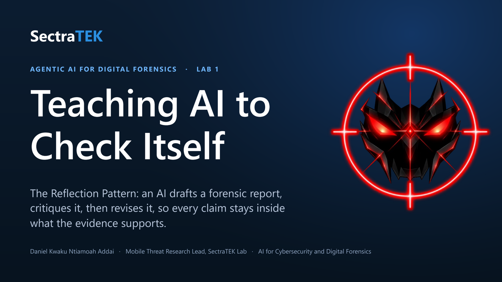
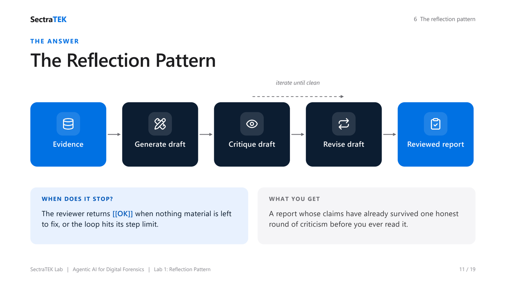
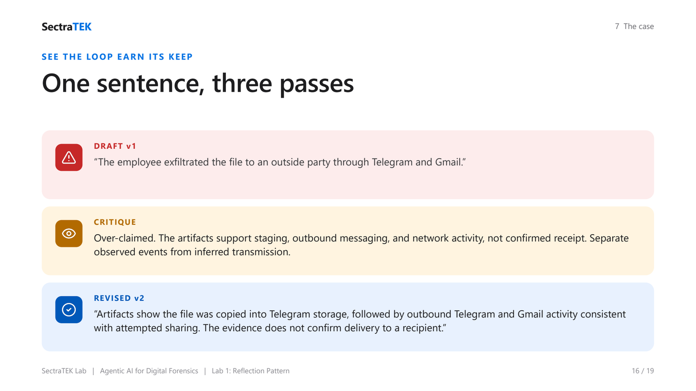

<p align="center">
  <a href="slides/SectraTEK_Lab1_Reflection.pdf"></a>
</p>

# Lab 1: The Reflection Pattern for Evidence-Bounded Reasoning

[](https://colab.research.google.com/github/danjethh/sectratek-AI-Lab/blob/main/lab1_reflection_pattern/03_lab_notebook.ipynb)

> Teach a model to check its own work. In this lab an AI drafts a forensic incident report,
> critiques it, and revises it, so that every claim stays inside what the evidence supports.

**Course:** AI for Cybersecurity and Digital Forensics - [SectraTEK AI Lab](../README.md)
**Pattern:** Reflection (generate, critique, revise, repeat)
**Case:** Suspected customer-data exfiltration, `DF-2026-017`
**Runtime:** Google Colab or any hosted Jupyter, free Groq endpoint, no local install
**Slides:** [lecture deck (PDF)](slides/SectraTEK_Lab1_Reflection.pdf) : [PowerPoint](slides/SectraTEK_Lab1_Reflection.pptx)

---

## Abstract

This lab introduces the **Reflection Pattern**: the simplest agentic loop, in which a model
generates an answer, criticizes that answer against the evidence, and revises it before the
answer is returned. The student applies the loop to a synthetic mobile-forensics case in which a
customer list appears on a company phone, is copied into a messaging app, and is then deleted.
The draft an LLM writes for this case is confident and wrong in a specific, instructive way: it
states that the file was *delivered* to an outside party, which the artifacts do not establish.
The lab uses reflection to pull that claim back to what the evidence supports, and in doing so
teaches the core forensic discipline of separating observation, inference, and claim. The student
first builds the loop by hand, then runs the same workflow through a reusable `ReflectionAgent`
class, and finally completes an evidence check that ties each surviving claim to a named artifact.

---

## Table of contents

1. [Background](#1-background)
2. [Problem statement](#2-problem-statement)
3. [Gaps this lab addresses](#3-gaps-this-lab-addresses)
4. [The solution: the Reflection Pattern](#4-the-solution-the-reflection-pattern)
5. [Methods and approach](#5-methods-and-approach)
6. [The case: DF-2026-017](#6-the-case-df-2026-017)
7. [Practical: running the lab](#7-practical-running-the-lab)
8. [Worked example](#8-worked-example)
9. [Discussion](#9-discussion)
10. [Learning outcomes and assessment](#10-learning-outcomes-and-assessment)
11. [Files in this lab](#11-files-in-this-lab)
12. [Credits](#12-credits)

---

## 1. Background

A forensic report is an argument about what happened, built only from what the evidence records.
Its credibility depends on a discipline that experienced examiners internalize: never state an
inference as a fact, cite an artifact and a timestamp for every claim, and say plainly where the
evidence runs out. Traditionally this discipline is enforced by a second person, a senior examiner
who reviews the draft, marks the overreach, and sends it back for revision.

Large language models break that arrangement. They draft fluently and fast, but they have no
built-in reviewer. Left alone, a model will write "the employee exfiltrated the file" because that
sentence is a likely continuation of the evidence it was shown, not because the evidence proves it.
The **Reflection Pattern** restores the missing reviewer by putting it inside the loop: the model
takes a second role and critiques its own draft before anyone reads it.

---

## 2. Problem statement

> **Given a set of phone artifacts that look incriminating, how do we get an AI-assisted report
> that says exactly what the evidence supports, and no more?**

The difficulty is that the artifacts in this case genuinely do show suspicious activity: a
sensitive file is copied into a messaging app, messages say "sending that sheet now" and "delete
after download," and the original file is deleted minutes later. A model, and an inexperienced
analyst, will read that as proof of exfiltration. It is not. The file being staged and messages
being sent is not the same as the file being received by another person. The lab's job is to make
that distinction visible and to use reflection to enforce it.

---

## 3. Gaps this lab addresses

| Gap | Without reflection | With reflection |
|---|---|---|
| **Overclaiming** | "The file was delivered to an outside party." | "The artifacts show staging and outbound activity consistent with attempted sharing; delivery is not confirmed." |
| **No self-check** | The first draft ships as-is. | The draft is criticized and revised before review. |
| **Hidden uncertainty** | Certainty is implied by fluent prose. | Uncertainty is stated explicitly and tied to missing evidence. |
| **Fact vs inference blur** | Inferences are written as observations. | Observation, inference, and claim are kept distinct. |

---

## 4. The solution: the Reflection Pattern

<p align="center">
  <br>
  <sub><em>The Reflection loop: the model drafts the report, a reviewer critiques it against the evidence, and it revises - repeating until nothing overreaches.</em></sub>
</p>


The pattern is a loop over three roles, all played by the **same model** with different
instructions:

```
            +-------------------- iterate until clean --------------------+
            v                                                             |
 Evidence -> [ Generate draft ] -> [ Critique draft ] -> [ Revise draft ] -+ -> Reviewed report
                (Analyst)             (Reviewer)            (Reviser)
```

- **The Analyst** writes the report and must cite a timestamp and an artifact for every claim.
- **The Reviewer** reads only the draft and flags overclaiming, provenance gaps, and weak
  uncertainty language. When nothing material remains, it outputs exactly `[[OK]]`.
- **The Reviser** takes the critique and rewrites the report, keeping the evidence in view.

The loop repeats until the Reviewer returns `[[OK]]` or a step limit is reached. The result is a
report whose claims have already survived one honest round of criticism before a human reads them.

---

## 5. Methods and approach

The notebook is in two parts, by design.

- **Part A: build the loop by hand.** The student issues each model call directly: prime the
  analyst, generate a draft, create a reviewer, critique the draft, feed the critique back, and
  revise. Every step has a short *Purpose / Input / Output* note so the mechanism is never hidden.
- **Part B: run the packaged agent.** The same workflow runs through a small `ReflectionAgent`
  class (a vendored copy of the course's `agentic_patterns` library). It manages the two chat
  histories, applies the `[[OK]]` stop rule, and bounds the number of cycles. The point is to show
  that the hand-built loop and the reusable class are the same idea at two levels of abstraction.

**Runtime.** The notebook connects to a free, OpenAI-compatible endpoint (Groq by default). The
key is entered with a hidden prompt and never saved. The notebook also writes the six case
artifacts to a local `data/` folder itself, so it runs standalone in Colab with no clone and no
install. See [../docs/GROQ_SETUP.md](../docs/GROQ_SETUP.md).

---

## 6. The case: DF-2026-017

- **Device:** Google Pixel 7, Android 14
- **Acquisition:** Cellebrite UFED, full file system; image hash recorded in the manifest
- **Incident window:** overnight, 15 February 2026 (UTC)
- **The file of interest:** `customers_q1.csv`

### Observed event sequence (UTC)

| Time | What the artifacts record |
|---|---|
| 01:05:22 | `customers_q1.csv` created in Downloads |
| 01:06:12 | same file accessed |
| 01:07:41 | same file hash copied into Telegram's `Documents` folder |
| 01:07:54 | outbound traffic to `api.telegram.org` |
| 01:07:58 | Telegram message out: "sending that sheet now" |
| 01:08:15 | Telegram message out: "delete after download" |
| 01:09:39 | outbound SMTP traffic via Gmail |
| 01:09:44 | Gmail message out: "see attached export" |
| 01:12:04 | `customers_q1.csv` deleted from Downloads |

These events are **consistent with** an attempt to share the file. They do **not**, on their own,
prove that the file reached any recipient. That gap is the heart of the lab.

### The artifacts (`data/`)

| File | Contents |
|---|---|
| `artifact_manifest.json` | Case, device, and integrity metadata |
| `file_events.csv` | File created / accessed / copied / deleted, with SHA-256 hashes |
| `app_db_messages.csv` | Telegram, Gmail, and Slack message excerpts |
| `network_events.csv` | Outbound connections, bytes, and the responsible process |
| `location_events.csv` | Approximate device location over time |
| `chain_of_custody.csv` | Handling and hash-verification log |

---

## 7. Practical: running the lab

1. Click the **Open in Colab** badge at the top of this page.
2. Run **Part 0** (setup): it installs the client, connects to Groq (paste a free key when
   prompted), and writes the case files.
3. Run **Part A** to build the reflection loop by hand: generate the draft, read the critique,
   see the revision.
4. Run **Part B** to run the same loop through `ReflectionAgent`.
5. Complete the **Evidence check** cell: answer the four questions in your own words.
6. Save and submit the notebook.

No local install is required. If the default model name is ever retired, the setup cell prints the
models available on your key so you can pick a current one.

**Before the notebook (optional):** if your instructor assigns the pre-lab group activity, examine
the raw `data/` files as a team and record a human baseline (timeline, claims, and what the
evidence does not establish) before opening the notebook. You will compare that baseline against
the model's draft, critique, and revision.

---

## 8. Worked example

<p align="center">
  <br>
  <sub><em>One sentence, three passes: a draft that overclaims, the critique that catches it, and the evidence-bounded revision.</em></sub>
</p>


**Draft v1 (overreaching):**

> "The employee exfiltrated `customers_q1.csv` to an outside party through Telegram and Gmail."

**Reflection critique:**

> Over-claimed. The artifacts support staging, outbound messaging, and network activity, not
> confirmed receipt. Separate observed events from inferred transmission, and state what remains
> uncertain.

**Revised v2 (defensible):**

> "Artifacts show that `customers_q1.csv` was copied into Telegram storage, followed by outbound
> Telegram and Gmail activity consistent with attempted external sharing. The current evidence does
> not confirm delivery to a recipient or that the same file was successfully transmitted through
> both channels."

The facts are identical across both versions. Only the certainty changes, and certainty is exactly
what a reviewer, and a court, tests.

---

## 9. Discussion

**Why this case is well chosen.** The evidence is suggestive enough that the wrong conclusion feels
right. That tension is the lesson. A student who can resist "exfiltrated" here has learned
something that transfers directly to real casework.

**What reflection does and does not do.** Reflection reliably removes obvious overreach and sharpens
uncertainty language. It does not verify facts against the world, and it does not replace the
examiner. A critique that says `[[OK]]` means the report is internally disciplined, not that the
conclusion is true.

**The vocabulary that carries the lab.** Observation (what an artifact records), inference (an
interpretation linking observations), and claim (a checkable statement in the report). Reflection
is the habit of checking that every claim has not drifted past its evidence.

---

## 10. Learning outcomes and assessment

By the end of this lab a student can:

1. Distinguish observed facts, inferences, and unsupported claims in a mobile forensic report.
2. Link each investigative claim to a specific artifact and timestamp.
3. Judge whether reflection made a model-generated report more evidence-bounded.
4. Name the forensic judgment that must remain with a human reviewer.

**Evidence check (in the notebook):**

1. Identify one claim in the draft that was too strong, and the artifacts that support a narrower
   claim instead.
2. Choose one claim in the revised report; give its artifact source and timestamp, and one limit.
3. State whether the critique improved the report's uncertainty language, with one before/after
   phrase.
4. Name the forensic judgment that must stay with a human.

Instructors: a scoring rubric and target-attainment guidance are in
[../docs/INSTRUCTOR_GUIDE.md](../docs/INSTRUCTOR_GUIDE.md).

---

## 11. Files in this lab

| Path | What it is |
|---|---|
| `03_lab_notebook.ipynb` | The hosted (Colab/Groq) student notebook |
| `data/` | The six synthetic case artifacts |
| `slides/SectraTEK_Lab1_Reflection.pptx` | The lecture deck for this lab |
| `README.md` | This document |

---

## 12. Credits

The case design and lab concept are adapted from **frankwxu/agentic-AI4-forensics**
(https://github.com/frankwxu/agentic-AI4-forensics). The `ReflectionAgent` is adapted from
**The Neural Maze's agentic-patterns-course** (https://github.com/neural-maze/agentic-patterns-course),
MIT License; see [../THIRD_PARTY_NOTICES.md](../THIRD_PARTY_NOTICES.md). The hosted adaptation,
notebook, slides, and documentation are by Daniel Kwaku Ntiamoah Addai, SectraTEK Lab.
