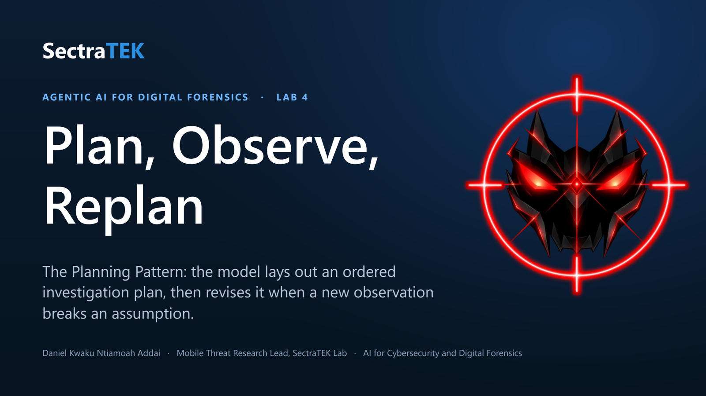
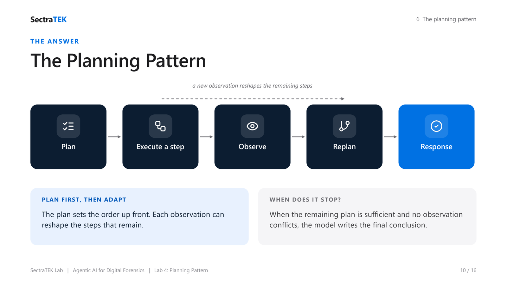
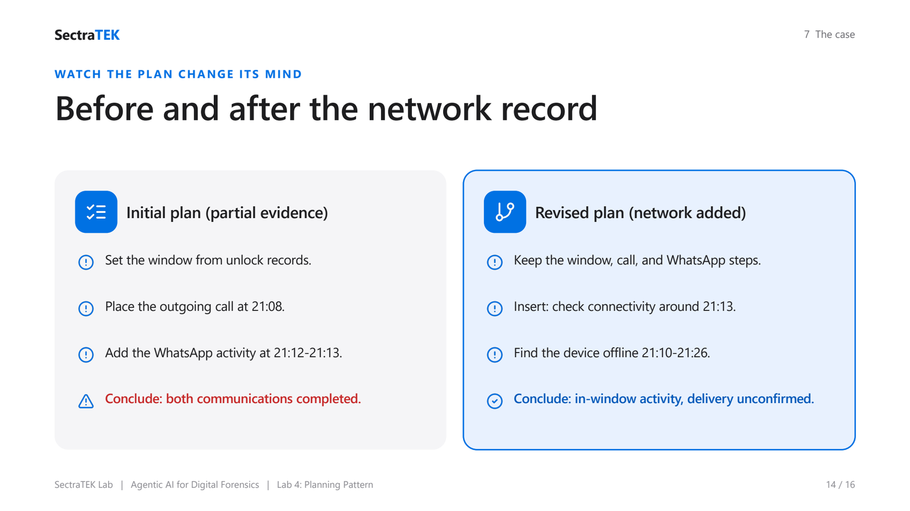

<p align="center">
  <a href="slides/SectraTEK_Lab4_Planning.pdf"></a>
</p>

# Lab 4: The Planning Pattern for Adaptive Timeline Reconstruction

[](https://colab.research.google.com/github/danjethh/sectratek-AI-Lab/blob/main/lab4_planning_pattern/03_lab_notebook.ipynb)

> Lay out the whole investigation as an ordered plan, then revise that plan when a new observation
> breaks one of its assumptions, instead of treating the first plausible timeline as final.

**Course:** AI for Cybersecurity and Digital Forensics - [SectraTEK AI Lab](../README.md)
**Pattern:** Planning (plan -> observe -> replan, then conclude)
**Case:** Timeline reconstruction of a missing phone, `PL-2026-011`
**Runtime:** Google Colab or any hosted Jupyter, free Groq endpoint, no local install
**Slides:** [lecture deck (PDF)](slides/SectraTEK_Lab4_Planning.pdf) : [PowerPoint](slides/SectraTEK_Lab4_Planning.pptx)

---

## Abstract

This lab introduces the **Planning Pattern**: for a larger question with several connected parts, the
model first produces an ordered investigation plan, then revises the remaining steps when a new
observation changes what an earlier step can support. The student reconstructs a phone's communication
timeline during a 30-minute window when it went missing. An initial plan is built from part of the
evidence, and a withheld **network-status record** then arrives and forces a replan: the device was
offline around the time of a WhatsApp image attachment, so an attachment recorded inside the window
cannot be called a confirmed delivery. The student walks the plan-replan loop by hand (Part A), then
runs it through a packaged `PlanningAgent` that builds, self-reviews, and revises a plan (Part B). The
lab contrasts Planning with Lab 3's ReAct: ReAct chooses the next step reactively, while Planning sets
an order up front and re-examines the whole path when the evidence shifts.

---

## Table of contents

1. [Background](#1-background)
2. [Problem statement](#2-problem-statement)
3. [Gaps this lab addresses](#3-gaps-this-lab-addresses)
4. [The solution: the Planning Pattern](#4-the-solution-the-planning-pattern)
5. [Methods and approach](#5-methods-and-approach)
6. [The case: PL-2026-011](#6-the-case-pl-2026-011)
7. [Practical: running the lab](#7-practical-running-the-lab)
8. [Worked example: the plan changes its mind](#8-worked-example-the-plan-changes-its-mind)
9. [Discussion](#9-discussion)
10. [Learning outcomes and assessment](#10-learning-outcomes-and-assessment)
11. [Files in this lab](#11-files-in-this-lab)
12. [Credits](#12-credits)

---

## 1. Background

Some forensic questions are answered one check at a time; others need a strategy. Reconstructing a
timeline across unlock records, a call log, app activity, and connectivity is the second kind: the
steps are connected, later steps depend on earlier ones, and a surprising record can change the meaning
of what you already found. A careful examiner plans the sequence before collecting, precisely so a late
surprise forces a conscious revision rather than slipping past as an assumption.

The **Planning Pattern** gives a model that habit. It builds an ordered plan with named **replanning
triggers**, carries out steps, and revises the remaining plan when an observation fires a trigger. It is
the natural partner to ReAct: a planner can set the overall path while ReAct carries out each step.

---

## 2. Problem statement

> **How do we stop an AI from locking onto its first plausible timeline when later evidence should
> change it?**

The case is built around a late-arriving record. An initial plan, seeing unlock records, a call, and
WhatsApp activity, naturally concludes that a call at 21:08 and a WhatsApp image near 21:13 were both
completed inside the window. But a network-status record, withheld until after the first plan, shows the
phone was offline from 21:10 to 21:26. A plan that cannot revise carries its early, uninformed
assumption straight into the conclusion. The right answer separates in-window **activity** from
confirmed **delivery**, and that only happens if the plan changes when the network record appears.

---

## 3. Gaps this lab addresses

| Gap | Without planning | With planning |
|---|---|---|
| **Locking onto the first timeline** | The first plausible sequence is treated as final. | The plan names triggers and expects to be revised. |
| **Ignoring late evidence** | A new record is appended without rethinking. | The remaining steps are reordered around the new fact. |
| **Activity read as delivery** | A WhatsApp image record means a sent message. | The offline window keeps delivery unconfirmed. |
| **Throwing away good work** | A surprise means starting over. | Still-valid steps are preserved; only what conflicts changes. |

---

## 4. The solution: the Planning Pattern

<p align="center">
  <br>
  <sub><em>The Planning loop: the model lays out an ordered plan first, executes a step, observes, and revises the remaining steps when a new observation changes the picture.</em></sub>
</p>


```
            +------- a new observation reshapes the remaining steps -------+
            v                                                              |
 Question -> [ Plan ] -> [ Execute a step ] -> [ Observe ] -> [ Replan ] --+ -> Response
             (ordered     (gather evidence)    (compare to    (revise the
              subgoals +                        assumptions)   remaining plan)
              triggers)
```

A good plan states **replanning triggers** up front, the conditions that would make it wrong:

- **A missing dependency:** a later step needs a fact no earlier step produced.
- **A contradiction:** a new record disagrees with something the plan assumed.
- **A timing conflict:** an event lands outside the window the plan was built on.

In this case the trigger that fires is a timing-and-contradiction one: the network log shows the phone
offline exactly when the WhatsApp attachment was recorded.

---

## 5. Methods and approach

The notebook is in two parts, by design.

- **Part A: walk the plan-replan loop by hand.** You build a **partial** evidence bundle that omits the
  network record, ask the model for an initial plan, then supply the network record as a late
  `new_observation` and ask the model to **revise** the plan. Finally you write a bounded timeline from
  the revised plan and the full evidence.
- **Part B: hand the case to `PlanningAgent`.** The packaged agent exposes `build_initial_plan`,
  `revise_plan`, and `run` (which builds a plan, then self-reviews and improves it until the review says
  `[[OK]]` or a replan limit is reached). You compare its revision with your manual one.

**Note on this lab's scope.** The notebook supplies the new observation deliberately; it does not choose
the next evidence to inspect. In the repository, `03b` and `03c` combine a planner with a `ReactAgent`
that gathers each observation with tools. This hosted notebook teaches the core plan-replan loop.

**Runtime.** The notebook connects to a free, OpenAI-compatible endpoint (Groq by default, model
`llama-3.3-70b-versatile`). The key is entered with a hidden prompt and never saved. The notebook writes
the six case artifacts to a local `data/` folder itself, so it runs standalone in Colab with no clone
and no install. See [../docs/GROQ_SETUP.md](../docs/GROQ_SETUP.md).

---

## 6. The case: PL-2026-011

- **Device:** Google Pixel 8, Android 14
- **Acquisition:** Cellebrite UFED, full file system; image hash recorded in the manifest
- **Scenario:** a caseworker's phone went missing for about 30 minutes during evening field visits
- **Incident window (UTC):** 20:55:00 to 21:25:00

### Observed event sequence (UTC)

| Time | What the records show |
|---|---|
| 20:55:03 | device unlocked (start of the missing period) |
| 21:08:14 | outgoing call to +1-555-0184, 42 seconds |
| 21:10:00 | mobile data drops offline |
| 21:12:07 | WhatsApp chat opened |
| 21:13:12 | a message with an image attachment is recorded, then deleted |
| 21:25:31 | device locked (end of the missing period) |
| 21:27:04 | mobile data restored (after the window) |

### The artifacts (`data/`)

| File | Contents |
|---|---|
| `artifact_manifest.json` | Case, device, and integrity metadata |
| `unlock_events.csv` | Device unlock and lock times |
| `call_log.csv` | The outgoing call, with duration and type |
| `whatsapp_events.csv` | WhatsApp chat open, a deleted message, an attachment record |
| `network_status.csv` | Online and offline time ranges (the withheld record) |
| `chain_of_custody.csv` | Acquisition and hash-verification log |

---

## 7. Practical: running the lab

1. Click the **Open in Colab** badge at the top of this page.
2. Run **Part 0** (setup): install the client, connect to Groq (paste a free key), write the case files,
   and load the planning framework.
3. Run **Part A**: build the partial and full bundles, create the initial plan, replan after the network
   observation, and write the final timeline.
4. Run **Part B**: build, revise, and `run` through `PlanningAgent`, and compare.
5. Write your own timeline and decision.
6. Save and submit the notebook.

No local install is required. If the default model name is ever retired, the setup cell prints the
models available on your key.

---

## 8. Worked example: the plan changes its mind

<p align="center">
  <br>
  <sub><em>The plan changes its mind: an initial plan concluded both communications completed, then revised once the network record showed the device was offline, so delivery is left unconfirmed.</em></sub>
</p>


| | Initial plan (partial evidence) | Revised plan (network added) |
|---|---|---|
| 1 | Set the window from unlock records. | Keep the window, call, and WhatsApp steps. |
| 2 | Place the outgoing call at 21:08. | Insert: check connectivity around 21:13. |
| 3 | Add the WhatsApp activity at 21:12 to 21:13. | Find the device offline 21:10 to 21:26. |
| Conclusion | Both communications completed in the window. | In-window activity; delivery unconfirmed. |

**Draft v1:** "Because there was a call at 21:08 and WhatsApp image activity near 21:13, both
communications were completed during the missing period."

**Final v2:** "The records show an outgoing call at 21:08 UTC and WhatsApp activity associated with an
image attachment at 21:13 UTC, both within the 20:55 to 21:25 window. Network records show the device
was offline from 21:10 until 21:26 UTC, so the available evidence does not confirm that the attachment
was delivered during the incident window."

The evidence steps are nearly the same; the ending is wiser because the plan absorbed the network record.

---

## 9. Discussion

**Replanning is the plan doing its job.** The value of writing a plan is not that it is right the first
time; it is that a named trigger turns a late surprise into a conscious revision. A model that revises
on evidence is behaving like a careful examiner, not a stubborn one.

**Planning versus ReAct.** ReAct decides the next action after each observation and suits bounded,
one-step-at-a-time questions. Planning sets an order up front and re-examines the whole path, and suits
larger problems with dependencies. The two compose: a planner picks the sequence, ReAct executes each
step.

**Activity is not delivery.** As in Labs 2 and 3, the hard discipline is stopping at what the records
support. The offline window around the attachment keeps "delivered" off the page. Holding that line is
the examiner's judgment, and a revisable plan makes it defensible.

---

## 10. Learning outcomes and assessment

By the end of this lab a student can:

1. Break a forensic timeline question into ordered subgoals with replanning triggers.
2. Build and carry out an initial plan from the available records.
3. Compare a new observation with the plan's assumptions and identify when the plan must change.
4. Reconstruct a timeline that separates in-window activity from later activity.
5. Produce an evidence-cited conclusion that states what remains unresolved.
6. Explain why an agent's suggested plan is an aid to review, not a final decision.

**Required answer:** a reconstructed timeline; a timing conclusion (which events are in the window); an
evidence mapping; and the remaining uncertainty, including that the offline gap leaves the WhatsApp
attachment unconfirmed as a delivery. Instructor guidance is in
[../docs/INSTRUCTOR_GUIDE.md](../docs/INSTRUCTOR_GUIDE.md).

---

## 11. Files in this lab

| Path | What it is |
|---|---|
| `03_lab_notebook.ipynb` | The hosted (Colab/Groq) student notebook |
| `data/` | The six synthetic case artifacts |
| `slides/SectraTEK_Lab4_Planning.pptx` | The lecture deck for this lab |
| `README.md` | This document |

---

## 12. Credits

The case design and lab concept are adapted from **frankwxu/agentic-AI4-forensics**
(https://github.com/frankwxu/agentic-AI4-forensics). The planning framework (`PlanningAgent`) is adapted
from **The Neural Maze's agentic-patterns-course**
(https://github.com/neural-maze/agentic-patterns-course), MIT License; see
[../THIRD_PARTY_NOTICES.md](../THIRD_PARTY_NOTICES.md). The hosted adaptation, notebook, slides, and
documentation are by Daniel Kwaku Ntiamoah Addai, SectraTEK Lab.
